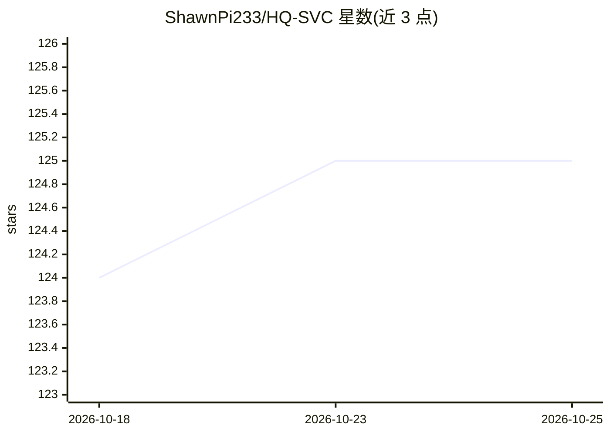

# ShawnPi233/HQ-SVC

⭐ 125 · Python · 推送 2026-06-17 · [GitHub](https://github.com/ShawnPi233/HQ-SVC) · 组织维护 · 中文 README

**零样本歌声转换与语音超分框架（AAAI 2026 论文）**

HQ-SVC 是面向低资源场景的零样本歌声转换（SVC）框架，配套 AAAI 2026 论文官方代码：通过统一解耦编解码器实现内容与说话人特征分离，结合多特征融合与渐进优化提升合成质量；支持对未见说话人免微调转换，同时提供 16kHz 到 44.1kHz 的语音超分能力。训练仅需单张消费级 GPU 和少于 80 小时数据。当前已发布推理代码与预训练模型，训练代码与歌声风格控制尚未发布。提供 Gradio 网页界面，仅在 Linux（CUDA >= 11.8）上测试通过。

## 筛选速览

| 维度 | 判定 | 备注 |
|---|---|---|
| AI 角色 | `ai-native` | 本体是模型或模型工具 |
| 许可风险 | `none` | — |
| 部署形态 | `None` |  |
| 模型依赖 | — | README 未给出锁定关系 |
| 硬件要求 | — | 无带数字的原话,不猜 |
| 安装摩擦 | `medium` | 含编译或系统依赖之一 |
| 成熟度 | — | 结构信号不足 |

## 能力要点

- 零样本歌声转换：对未见说话人无需微调
- 双能力：高质量歌声转换 + 16kHz→44.1kHz 语音超分
- 低资源训练：单张消费级 GPU、<80h 数据
- Gradio 网页界面运行推理

## 适用场景

- 我想把一段歌声转换成目标歌手的音色且无需训练
- 将低采样率（16kHz）音频提升到 44.1kHz
- 复现论文的 SVC 推理实验结果

## 场景标签

 · 领域:语音处理/歌声转换

## 证据(README 行号)

> L12: HQ-SVC is an efficient framework for high-quality zero-shot singing voice conversion (SVC) in low-resource scenario
> L16: - ⚡ Low-resource training (single consumer-grade GPU, <80h data)
> L17: - 🎧 Dual capabilities: high-quality singing voice conversion + voice super-resolution

## 星数曲线

2026-10-18 124 → 2026-10-25 125（+1）

---
*卡片 v1 · prompt 1.4 · 生成 2026-10-23 · 置信度 high · 依据 README sha `4b4e90e2dbf7` · [字段定义](../../DATASET.md)*
