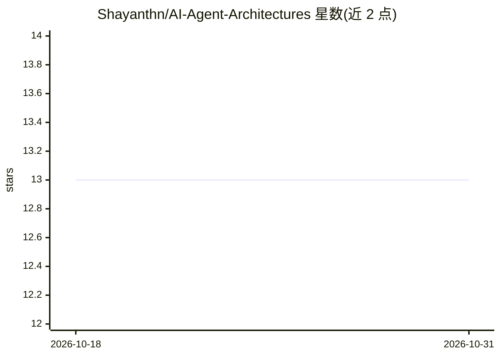

# Shayanthn/AI-Agent-Architectures

⭐ 13 · Jupyter Notebook · MIT · 推送 2025-11-22 · [GitHub](https://github.com/Shayanthn/AI-Agent-Architectures) · 个人维护

**AI Agent 架构教学仓库：17+ 种模式的可运行 Jupyter 实现**

以'活教材'形式收录 17+ 种 AI agent 架构（Reflection、ReAct、Multi-Agent、Tree of Thoughts、元认知等），每种附端到端可运行的 Jupyter notebook，用 LangChain/LangGraph 实现，LLM 由 Nebius AI 模型（如 Mixtral-8x22B）驱动。notebook 按渐进难度排序为五个学习阶段，多数包含 LLM-as-a-Judge 评测模式；示例场景涵盖金融分析、编码、医疗分诊。运行需 Python 3.10+ 虚拟环境、pip 安装依赖并配置 Nebius/Tavily 等 API key。

## 筛选速览

| 维度 | 判定 | 备注 |
|---|---|---|
| AI 角色 | `ai-knowledge` | 知识聚合/清单类 |
| 许可风险 | `permissive` | MIT |
| 部署形态 | `library` | 以包/库形式分发 |
| 模型依赖 | — | README 未给出锁定关系 |
| 硬件要求 | — | 无带数字的原话,不猜 |
| 安装摩擦 | `low` | 无编译、无系统依赖或容器化 |
| 成熟度 | — | 结构信号不足 |

## 能力要点

- 17+ 种 agent 架构各附可运行 Jupyter notebook
- 以 LangGraph 为核心编排框架，多数 notebook 含 LLM-as-a-Judge 评测
- 五阶段渐进式学习路径，从基础模式到多智能体与自改进系统

## 适用场景

- 系统学习现代 AI agent 设计模式并动手运行代码
- 为生产 agent 选型参考 PEV、Dry-Run 等安全架构
- 了解多智能体、记忆、元认知等架构的实现方式

## 场景标签

`教程课程` · 领域:学习与行业

## 证据(README 行号)

> L5: Welcome to a comprehensive, hands-on masterclass in **modern AI agent design**. This repository contains detailed im
> L19: - **From Theory to Tangible Code:** Each architecture is not just explained but implemented end-to-end in a runnabl

## 星数曲线

2026-10-18 13 → 2026-10-31 13（+0）

---
*卡片 v1 · prompt 1.4 · 生成 2026-10-31 · 置信度 high · 依据 README sha `5083cf821944` · [字段定义](../../DATASET.md)*
