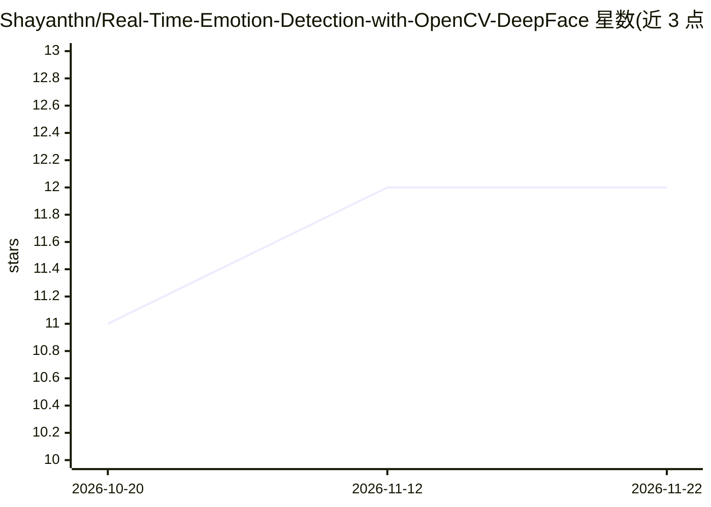

# Shayanthn/Real-Time-Emotion-Detection-with-OpenCV-DeepFace

⭐ 12 · Python · MIT · 推送 2026-09-25 · [GitHub](https://github.com/Shayanthn/Real-Time-Emotion-Detection-with-OpenCV-DeepFace) · 个人维护

**实时摄像头人脸表情识别系统，输出7类表情**

计算机工程专业项目：从摄像头捕获画面，用 OpenCV Haar 级联做面部检测，以 FER2013 Mini-XCEPTION 预训练模型将表情分为7类（Happy/Sad/Angry/Surprise/Fear/Disgust/Neutral），DeepFace 作为模型缺失时的回退方案。带赛博朋克风格 HUD 与实时概率条、屏幕录制功能，采用帧节流与多线程分析管线。README 附 FER2013 PublicTest 集评测（准确率 0.54）与本地推理延迟/FPS 实测，明确声明系统做的是表情分类而非内部情绪状态测量。

## 筛选速览

| 维度 | 判定 | 备注 |
|---|---|---|
| AI 角色 | `ai-native` | 本体是模型或模型工具 |
| 许可风险 | `permissive` | MIT |
| 部署形态 | `library` | 以包/库形式分发 |
| 模型依赖 | — | README 未给出锁定关系 |
| 硬件要求 | — | 无带数字的原话,不猜 |
| 安装摩擦 | `low` | 无编译、无系统依赖或容器化 |
| 成熟度 | — | 结构信号不足 |

## 能力要点

- FER2013 Mini-XCEPTION 预训练模型，64x64 灰度输入，7 类表情分类
- DeepFace 作为模型不可用时的回退方案
- 帧节流与多线程分析管线，带 HUD 概率条与屏幕录制
- 附 FER2013 评测基准与本地推理延迟/FPS 实测数据

## 适用场景

- 通过摄像头实时识别画面中的面部表情
- 在 FER2013 数据集上复现评测与训练实验
- 内容创作时录制带表情识别 HUD 的视频

## 场景标签

`人脸识别` · 领域:感知与多模态

## 证据(README 行号)

> L14: This project classifies visible facial expressions from webcam frames into seven predefined classes using OpenCV, H
> L94: 2. **Expression Classification**: FER2013 Mini-XCEPTION model

## 星数曲线

2026-10-20 11 → 2026-11-22 12（+1）

---
*卡片 v1 · prompt 1.4 · 生成 2026-11-18 · 置信度 high · 依据 README sha `5478c7742e14` · [字段定义](../../DATASET.md)*
