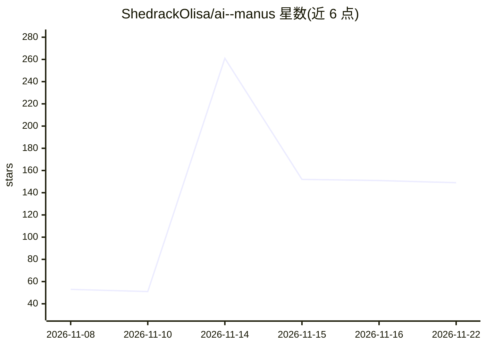

# ShedrackOlisa/ai--manus

⭐ 149 · Apache-2.0 · 推送 2026-11-08 · [GitHub](https://github.com/ShedrackOlisa/ai--manus) · 个人维护

**面向日常任务的自主 AI Agent：自动执行代码与浏览器操作**

README 描述 Manus 为自主 AI 代理，可代用户编写并执行脚本、控制浏览器（导航网页、填写表单、采集信息），并执行多步骤任务，定位为家庭、学习与轻量办公场景的个人助理，面向非开发者用户。正文给出兼容性表（最低 4GB 内存、双核 CPU）与上手、使用建议等说明性内容。注意：README 未给出任何安装命令、下载链接、模型接入方式或代码结构说明，且行文为推广式表述，技术细节不足。

## 筛选速览

| 维度 | 判定 | 备注 |
|---|---|---|
| AI 角色 | `ai-native` | 本体是模型或模型工具 |
| 许可风险 | `permissive` | Apache-2.0 |
| 部署形态 | `None` |  |
| 模型依赖 | — | README 未给出锁定关系 |
| 硬件要求 | — | 无带数字的原话,不猜 |
| 安装摩擦 | `low` | 无编译、无系统依赖或容器化 |
| 成熟度 | — | 结构信号不足 |

## 能力要点

- 自主执行代码：代理自行编写并运行脚本完成任务
- 浏览器控制：导航网页、填写表单、跨页采集信息
- 代码与浏览器操作可在同一任务流中衔接
- 面向非开发者的家庭、学习与轻量办公场景

## 适用场景

- 让代理代为完成重复的网页查资料与填表操作
- 整理研究笔记、运行小脚本等学习任务
- 远程工作中跨多个页面收集信息并生成小结

## 场景标签

`AI 助手` `浏览器自动化` `编码 Agent` · 领域:效率与自动化

## 证据(README 行号)

> L10: - **Autonomous Code Execution:** Manus AI agent runs code on its own to complete tasks, so you can focus on decisio
> L18: Manus is an autonomous AI agent designed to run code and control a browser on your behalf. Instead of acting like a

## 星数曲线

2026-11-08 53 → 2026-11-22 149（+96）

---
*卡片 v1 · prompt 1.4 · 生成 2026-11-17 · 置信度 low · 依据 README sha `bb01866e51a8` · [字段定义](../../DATASET.md)*
