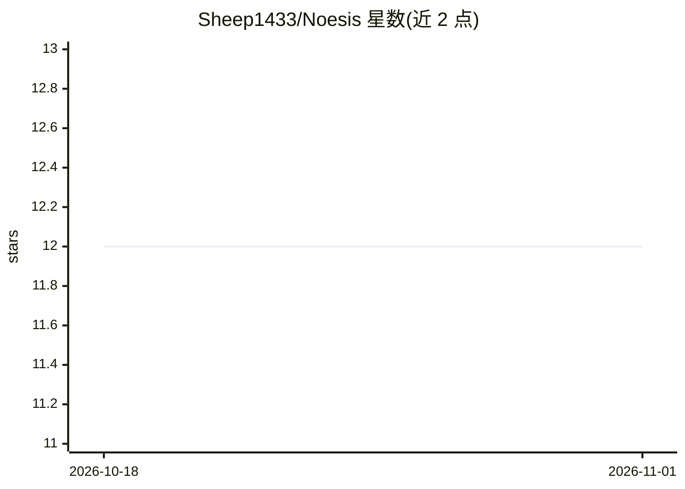

# Sheep1433/Noesis

⭐ 12 · Python · 推送 2026-10-22 · [GitHub](https://github.com/Sheep1433/Noesis) · 个人维护 · 中文 README

**自托管多智能体全栈平台：问答、深度研究、故障运维、用例生成**

基于 Vue 3 + FastAPI + LangGraph 的自托管 AI 对话平台，包含四类场景 Agent：RAG 知识库问答、自主调研与多步任务编排的智能体（深度研究）、经 MCP 连接运维工具定位故障根因的故障运维、分阶段生成测试用例并脑图可视化确认。配套知识库（DeepDoc 解析 + hybrid 检索 + rerank）、五类自动记忆、后台子 Agent、Skills 管理、MCP 客户端、Langfuse 可观测接入。模型经 DashScope（Qwen）/OpenAI 兼容接口接入，工具执行走 Docker 沙箱。生产需同源 HTTPS 部署并配置 PostgreSQL/Qdrant 等依赖。

## 筛选速览

| 维度 | 判定 | 备注 |
|---|---|---|
| AI 角色 | `ai-native` | 本体是模型或模型工具 |
| 许可风险 | `none` | — |
| 部署形态 | `self-host` | docker 或自建部署 |
| 模型依赖 | — | README 未给出锁定关系 |
| 硬件要求 | — | 无带数字的原话,不猜 |
| 安装摩擦 | `low` | 无编译、无系统依赖或容器化 |
| 成熟度 | — | 结构信号不足 |

## 能力要点

- 四类场景 Agent：RAG 问答、深度研究、MCP 故障运维、测试用例生成
- 知识库支持 DeepDoc 解析、hybrid 检索 + rerank 与引用溯源
- 会话终态增量抽取五类记忆并自动注入新会话
- SSE 流式展示推理与工具调用，Docker 沙箱执行工具

## 适用场景

- 私有部署团队知识库问答与深度调研
- 通过 MCP 连接运维工具做多步根因定位
- 基于需求文档自动生成测试场景与用例

## 场景标签

`多智能体` `文档问答` `科研工具` · 领域:Agent 开发

## 证据(README 行号)

> L3: Noesis 是一个基于 **Vue 3 + FastAPI + LangGraph** 的全栈 AI 对话平台，面向多场景智能体协作：通用问答、故障运维、深度研究与测试用例生成。前端通过 SSE 流式展示推理与工具调用过程；后端统
> L9: |智能问答|GeneralQAAgent|RAG hybrid 检索 + 联网搜索|知识库增强的多轮对话，支持附件上传与引用溯源|
> L10: |智能体|SuperAgent|文件系统 + Skills + 联网检索|自主调研、多步任务编排与报告产出（原深度研究）|

## 星数曲线

2026-10-18 12 → 2026-11-01 12（+0）

---
*卡片 v1 · prompt 1.4 · 生成 2026-11-01 · 置信度 mid · 依据 README sha `34c0de7f307a` · [字段定义](../../DATASET.md)*
