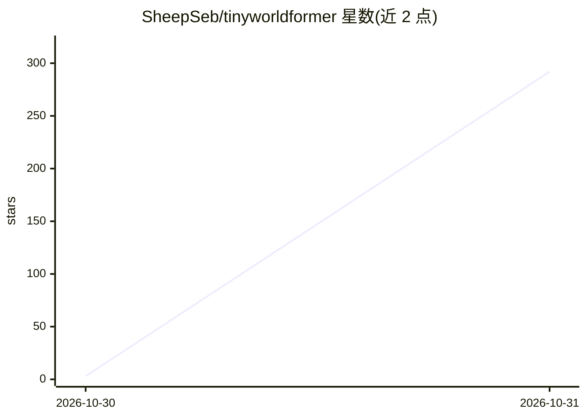

# SheepSeb/tinyworldformer

⭐ 292 · Rust · 推送 2026-10-27 · [GitHub](https://github.com/SheepSeb/tinyworldformer) · [官网](https://sheepseb.github.io/stealth/posts/tinyworldformer.html) · 个人维护

**在树莓派 Pico 2W 上生成并游玩游戏的微型世界模型**

在 RP2350 微控制器上同时运行两个小型神经网络：一个 26k–131k 参数的循环 Transformer 世界模型（int8 量化），根据当前帧与动作预测下一帧和奖励，生成 Breakout、Doom-lite、Flappy Bird、Pong、Pac-Man lite 五种游戏；另一个 9k–16k 参数的 MLP actor（Stream AC(λ)，单步流式强化学习）在生成的'梦境'中选动作并可在板上从头学习。附带 numpy 实现的真实游戏规则用于逐帧校验世界模型，int8 权重写入 Rust 源码并烧录固件运行。面向嵌入式 AI 与世界模型方向的开发者/研究者。

## 筛选速览

| 维度 | 判定 | 备注 |
|---|---|---|
| AI 角色 | `ai-native` | 本体是模型或模型工具 |
| 许可风险 | `none` | — |
| 部署形态 | `None` |  |
| 模型依赖 | — | README 未给出锁定关系 |
| 硬件要求 | — | 无带数字的原话,不猜 |
| 安装摩擦 | `low` | 无编译、无系统依赖或容器化 |
| 成熟度 | — | 结构信号不足 |

## 能力要点

- 循环 Transformer 世界模型（单块权重循环 1–4 次），逐帧预测下一帧与奖励
- int8 权重与激活量化，手写 no_std Rust 反向传播，单板 RP2350 上运行
- Stream AC(λ) 流式强化学习 agent 可在板上的'梦境'内从头学习
- 用 numpy 真实规则逐帧校验生成帧，报告各游戏精确帧率

## 适用场景

- 研究微型世界模型在微控制器上的可行性
- 在 Pico 2W 上体验 AI 生成并可由 AI 游玩的小游戏
- 学习循环 Transformer、int8 量化与流式 RL 的实现细节

## 场景标签

`强化学习` `模型量化` · 领域:训练与推理

## 证据(README 行号)

> L3: Using 2 small neural networks to generate and play the game at the same time on a Raspberry Pi Pico 2 W. The first o
> L13: I got interested in looped transformers, where one transformer block is applied several times with the same weights

## 星数曲线

2026-10-30 3 → 2026-10-31 292（+289）

---
*卡片 v1 · prompt 1.4 · 生成 2026-10-30 · 置信度 high · 依据 README sha `31956f33990e` · [字段定义](../../DATASET.md)*
