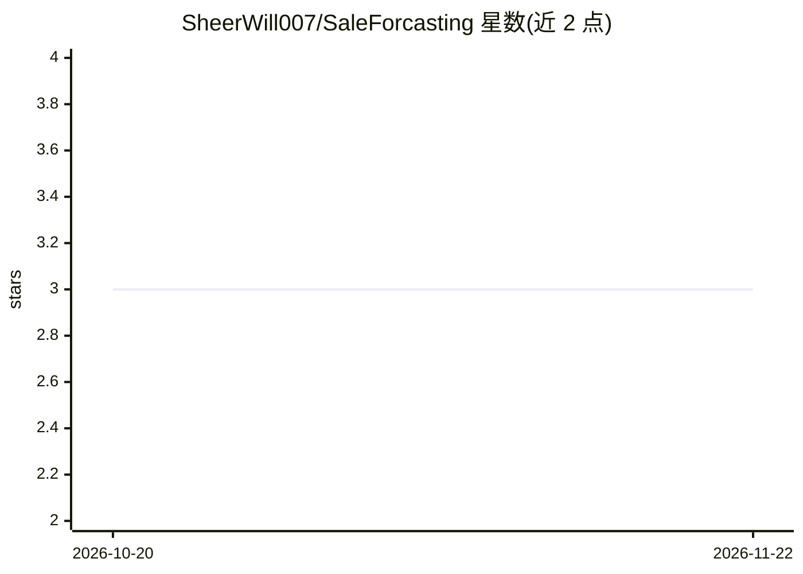

# SheerWill007/SaleForcasting

⭐ — · [GitHub]() · 个人维护

**给业务/数据用户用的销售预测与分析仪表盘平台**

SalesCast 是一个全栈销售预测与分析平台：FastAPI 后端读取销售交易数据（CSV/Excel 上传），在首次启动时自动训练预测模型并持久化（joblib），通过带 Swagger/OpenAPI 文档的 REST API 提供汇总分析、预测与逐月实际/预测对比的评估视图；Next.js/TypeScript 前端以 Recharts 仪表盘呈现结果。自带合成样本数据集，安装后无需外部数据即可运行；支持双开发服务器或 FastAPI 单进程托管静态导出前端两种模式，含 Docker/Compose 部署与 pytest API 测试。README 提示预测为统计估计，依赖训练数据质量，不能覆盖训练历史之外的事件。

## 筛选速览

| 维度 | 判定 | 备注 |
|---|---|---|
| AI 角色 | `ai-native` | 本体是模型或模型工具 |
| 许可风险 | `viral` | — |
| 部署形态 | `self-host` | docker 或自建部署 |
| 模型依赖 | — | README 未给出锁定关系 |
| 硬件要求 | — | 无带数字的原话,不猜 |
| 安装摩擦 | `low` | 无编译、无系统依赖或容器化 |
| 成熟度 | — | 结构信号不足 |

## 能力要点

- 首次启动自动训练并持久化预测模型，后续启动直接加载
- 模型评估视图逐月对比实际值与预测值
- 支持 CSV/Excel 上传（最大 350 MB 可配），上传数据与样本数据分开存储
- 多阶段 Docker 构建，生产模式下单进程同时服务 API 与静态前端

## 适用场景

- 分析自有历史销售数据并生成前瞻性销量预测
- 评估预测模型在实际业务数据上的可靠性
- 将预测与分析仪表盘以 Docker 方式部署给团队使用

## 场景标签

`数据分析` · 领域:效率与自动化

## 证据(README 行号)

> L3: SalesCast is a full-stack sales forecasting and analytics platform. A FastAPI backend ingests transactional sales da
> L12: - What is likely to happen? Forward-looking sales forecasts produced by a trained model.
> L20: - **Forecasting.** A persisted machine learning model that is trained automatically on first start and reloaded on 

## 星数曲线

2026-10-20 3 → 2026-11-22 3（+0）

---
*卡片 v1 · prompt 1.4 · 生成 2026-11-22 · 置信度 high · 依据 README sha `ad33c0330f7c` · [字段定义](../../DATASET.md)*
