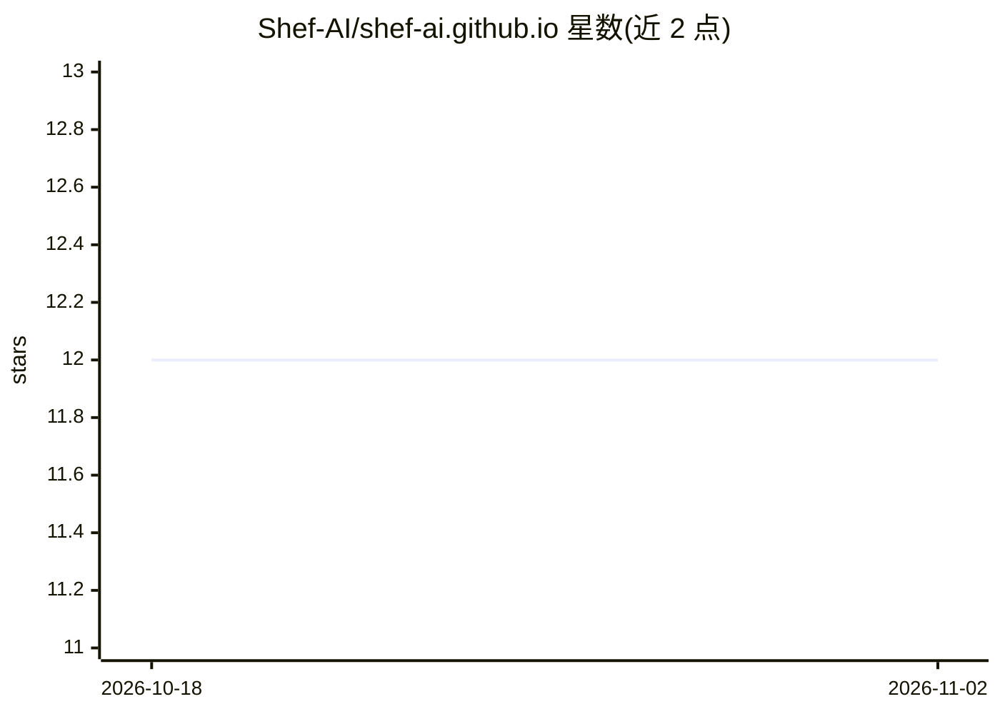

# Shef-AI/shef-ai.github.io

⭐ 12 · HTML · MIT · 推送 2026-09-29 · [GitHub](https://github.com/Shef-AI/shef-ai.github.io) · [官网](https://shef-ai.github.io/) · 组织维护

**谢菲尔德数据科学与 AI 社区的官方网站代码仓库**

本仓库是 Sheffield Data Science and AI Community（Shef.AI）的官方网站源码。README 仅记录网站内容维护流程：如何通过 LinkedIn 帖子的嵌入 URL 更新 `media-linkedin.json`，以及如何将文本转为单行 HTML/JSON 后更新 `news.json`、`events.json` 等数据文件来维护新闻与活动内容。不提供模型、数据集或算法，仅面向社区网站维护者，另附隐私声明链接。

## 筛选速览

| 维度 | 判定 | 备注 |
|---|---|---|
| AI 角色 | `ai-knowledge` | 知识聚合/清单类 |
| 许可风险 | `permissive` | MIT |
| 部署形态 | `None` |  |
| 模型依赖 | — | README 未给出锁定关系 |
| 硬件要求 | — | 无带数字的原话,不猜 |
| 安装摩擦 | `low` | 无编译、无系统依赖或容器化 |
| 成熟度 | — | 结构信号不足 |

## 能力要点

- Sheffield 数据科学与 AI 社区官方网站的源码仓库
- 通过 json 目录下的 JSON 文件维护新闻/活动/嵌入内容
- 提供 LinkedIn 帖子嵌入与多行转单行文本的操作流程说明

## 适用场景

- 作为社区成员查看本社区网站的源码
- 按流程更新网站上的新闻、活动与 LinkedIn 嵌入帖

## 场景标签

 · 领域:社区/知识传播

## 证据(README 行号)

> L4:  Sheffield Data Science and AI Community
> L11: This is the official website for the Sheffield Data Science and AI Community.

## 星数曲线

2026-10-18 12 → 2026-11-02 12（+0）

---
*卡片 v1 · prompt 1.4 · 生成 2026-11-01 · 置信度 high · 依据 README sha `ae264a72926f` · [字段定义](../../DATASET.md)*
