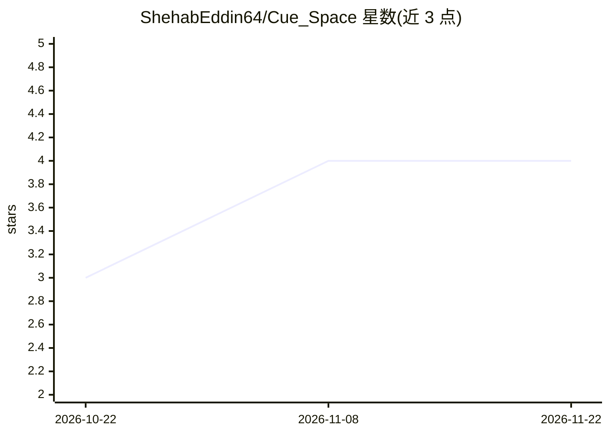

# ShehabEddin64/Cue_Space

⭐ 4 · TypeScript · MIT · 推送 2026-10-20 · [GitHub](https://github.com/ShehabEddin64/Cue_Space) · [官网](https://shehabeddin64.github.io/Cue_Space/) · 个人维护

**Mac 活动工作区启动器：一键打开链接、应用、文件并排布窗口**

macOS 桌面效率工具，核心概念是 Cue：把一个活动所需的链接、应用、文件和文件夹保存为一体，一键按顺序打开并按用户偏好排布到多个桌面（全屏/分屏/四分格，Mission Control 式预览）。Cue 可手动创建，也可由 AI 根据自然语言描述生成提案后人工确认；内置 MCP 服务器与命令行工具，可让 Claude Desktop 或 ChatGPT 远程创建 Cue。启动 Cue 不调用 AI，本地 JSON 存储，无账号无云，AI 密钥存于 macOS 钥匙串。提供 dmg 安装包，支持英文与法语。

## 筛选速览

| 维度 | 判定 | 备注 |
|---|---|---|
| AI 角色 | `ai-enhanced` | 去掉 AI 部分产品仍成立 |
| 许可风险 | `permissive` | MIT |
| 部署形态 | `desktop` | 安装包/桌面程序 |
| 模型依赖 | locked-api |  |
| 硬件要求 | — | 无带数字的原话,不猜 |
| 安装摩擦 | `medium` | 含编译或系统依赖之一 |
| 成熟度 | — | 结构信号不足 |

## 能力要点

- 一键启动 Cue：按序打开链接、应用、文件/文件夹并跨桌面排布窗口
- 自然语言描述生成 Cue 提案，也可完全手动创建（AI 非必需）
- 内置 MCP 服务器与 cuespace-cli，支持 Claude Desktop/ChatGPT 接入
- 本地优先：Cue 为本地 JSON，启动不使用 AI，可离线运行

## 适用场景

- 为学习或项目一键打开课程、编辑器、笔记等全部资源
- 让 Claude Desktop 通过对话帮我生成每日晨间工作 Cue
- 多显示器/多桌面下自动排布应用窗口
- 不依赖云端、离线管理自己的工作区

## 场景标签

 · 领域:效率工具/桌面应用

## 证据(README 行号)

> L37: Tell Cue Space what you want to do and your own AI proposes the Cue, using apps you actually have. Review it, fix a
> L51: - **Slash commands:** `/add figma, ~/Notes`, `/off localhost`, `/start atlas`. Most run on your Mac with no AI at a
> L83: - **AI creates, Cue Space executes:** starting a Cue never uses AI. It opens exactly what’s saved, every time, offl

## 星数曲线

2026-10-22 3 → 2026-11-22 4（+1）

---
*卡片 v1 · prompt 1.4 · 生成 2026-11-21 · 置信度 high · 依据 README sha `53442c7261a0` · [字段定义](../../DATASET.md)*
