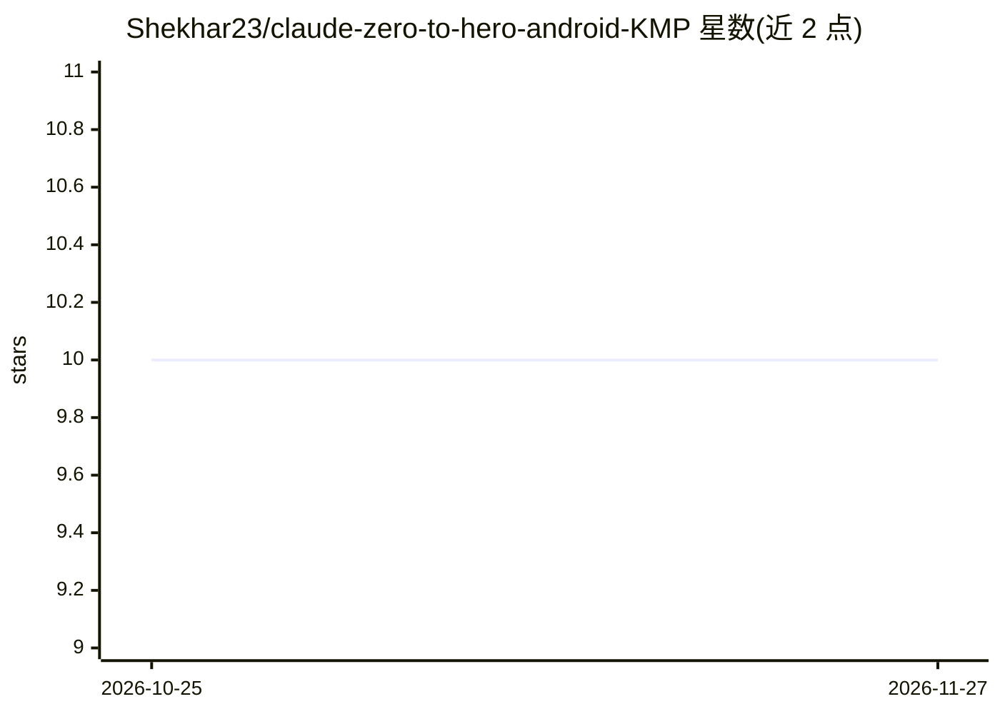

# Shekhar23/claude-zero-to-hero-android-KMP

⭐ 10 · 推送 2026-03-29 · [GitHub](https://github.com/Shekhar23/claude-zero-to-hero-android-KMP) · 个人维护

**40 份技能文档，让 Claude Code 生成符合规范的 Android/KMP 代码**

面向 Android/KMP 开发的技能文档库：每个主题一份 SKILL.md，含模式说明、Kotlin 示例、实现清单与反模式警示，覆盖架构（MVI、Compose、KMP）、数据层、测试、CI/CD 等 40 个主题。文档可装入 Claude Code（自动按任务匹配技能）、粘贴给 Claude.ai 或配置给 GitHub Copilot 使用。附带 8 个场景提示词库与任务-技能速查表，并提供用全部技能从单个提示词生成的示例应用 TaskVault。

## 筛选速览

| 维度 | 判定 | 备注 |
|---|---|---|
| AI 角色 | `ai-knowledge` | 知识聚合/清单类 |
| 许可风险 | `none` | — |
| 部署形态 | `None` |  |
| 模型依赖 | — | README 未给出锁定关系 |
| 硬件要求 | — | 无带数字的原话,不猜 |
| 安装摩擦 | `low` | 无编译、无系统依赖或容器化 |
| 成熟度 | — | 结构信号不足 |

## 能力要点

- 40 个 SKILL.md 技能文档，每个含代码示例、清单与反模式警告
- 支持 Claude Code 技能系统、Claude.ai 粘贴、GitHub Copilot 配置三种用法
- 8 个提示词模板与 16 类任务到技能组合的速查表
- 提供用全部技能生成的完整示例应用 TaskVault

## 适用场景

- 让 AI 助手按统一的 MVI/Compose 架构生成 Android 代码
- 在现有项目中按技能组合查找开发任务对应的规范文档
- 用 create-demo-app.md 从零生成完整 Android 应用骨架

## 场景标签

`提示工程` `编码 Agent` `AI 助手` `代码生成` · 领域:Agent 开发

## 证据(README 行号)

> L14: A focused library of **skill documents** — one per Android/KMP topic — that give AI coding assistants (Claude Code,
> L25:     SKILL.md              — pattern guide with Kotlin examples and checklist

## 星数曲线

2026-10-25 10 → 2026-11-27 10（+0）

---
*卡片 v1 · prompt 1.4 · 生成 2026-11-20 · 置信度 high · 依据 README sha `274764adac73` · [字段定义](../../DATASET.md)*
