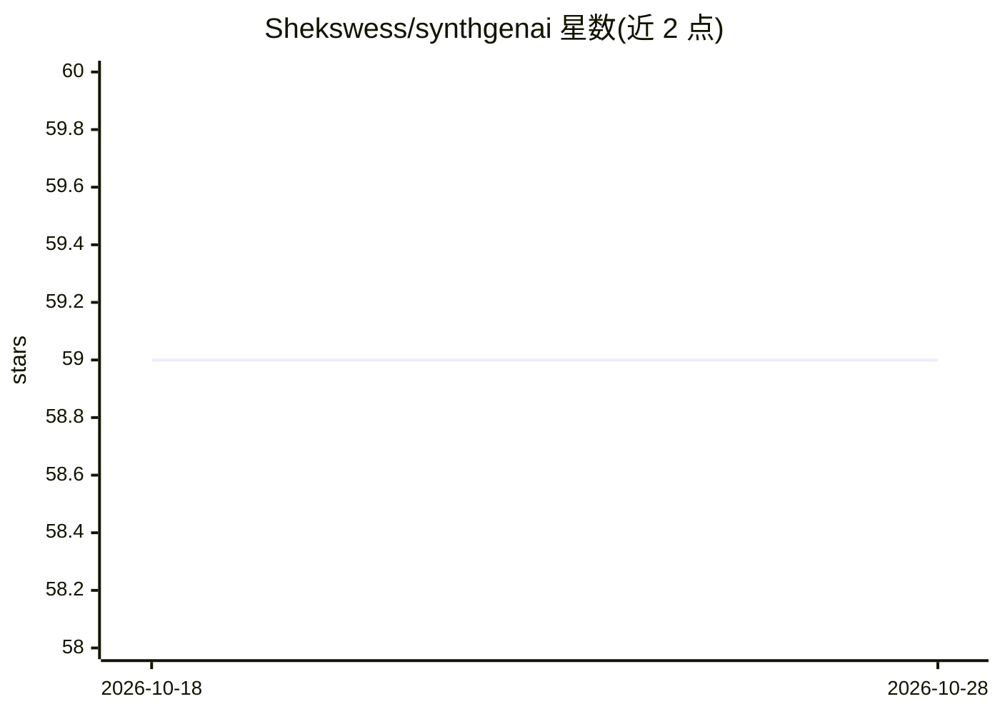

# Shekswess/synthgenai

⭐ 59 · Python · MIT · 推送 2025-11-24 · [GitHub](https://github.com/Shekswess/synthgenai) · [官网](https://shekswess.github.io/synthgenai/) · 个人维护

**用多供应商 LLM 生成合成数据集的 Python 包**

SynthGenAI 是一个模块化的 Python 包，通过 LiteLLM 调用多家 LLM API 供应商（Groq、Mistral、Gemini、Bedrock、Anthropic、OpenAI、Ollama、vLLM 等 15 家）生成六类合成数据集：Raw、Instruction、Preference、情感分析、摘要与文本分类，支持同步与异步生成。可选集成 Langfuse 做 LLM 可观测性、Hugging Face Hub 保存数据集、Gradio 提供 UI。提供 CLI 与 pip/uv 安装，README 声明仍处于早期开发阶段，部分功能可能未完整实现或测试；推荐使用支持 JSON 结构化输出的模型。

## 筛选速览

| 维度 | 判定 | 备注 |
|---|---|---|
| AI 角色 | `ai-native` | 本体是模型或模型工具 |
| 许可风险 | `permissive` | MIT |
| 部署形态 | `library` | 以包/库形式分发 |
| 模型依赖 | local-ok | 支持本地模型 |
| 硬件要求 | — | 无带数字的原话,不猜 |
| 安装摩擦 | `low` | 无编译、无系统依赖或容器化 |
| 成熟度 | `idea` | |

## 能力要点

- 支持 15 家 LLM API 供应商（经 LiteLLM 以 OpenAI 格式统一接入）
- 可生成 6 类数据集（Raw/Instruction/Preference/情感分析/摘要/文本分类）
- 同步与异步两种生成模式
- 可选 Langfuse 可观测、Hugging Face Hub 数据集保存与 Gradio UI

## 适用场景

- 用 LLM 生成指令或偏好数据集用于模型训练
- 在隐私受限或数据获取成本高时补充训练数据
- 切换不同 LLM 供应商批量生成领域数据集

## 场景标签

 · 领域:LLM 数据工程/合成数据

## 证据(README 行号)

> L5: SynthGenAI is a package for generating Synthetic Datasets. The idea is to have a tool which is simple to use and can
> L19: - LiteLLM, A Python SDK for accessing LLMs from different API providers with standardized OpenAI Format.
> L122: Currently there are six types of datasets that can be generated using SynthGenAI:

## 星数曲线

2026-10-18 59 → 2026-10-28 59（+0）

---
*卡片 v1 · prompt 1.4 · 生成 2026-10-24 · 置信度 high · 依据 README sha `0bd2857b69ab` · [字段定义](../../DATASET.md)*
