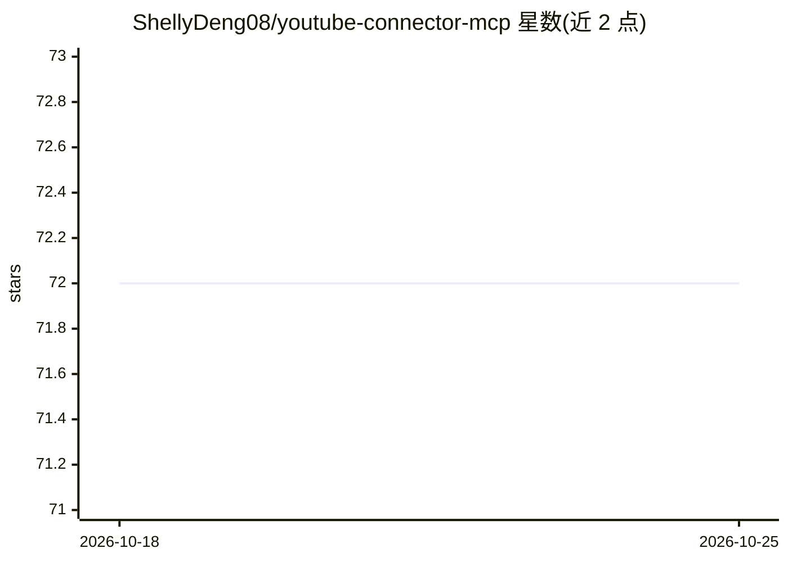

# ShellyDeng08/youtube-connector-mcp

⭐ 72 · Python · 推送 2026-03-19 · [GitHub](https://github.com/ShellyDeng08/youtube-connector-mcp) · [官网](https://youtube-connector-mcp-website.vercel.app/) · 个人维护 · 中文 README

**让 AI 助手通过 MCP 访问 YouTube 数据的连接器服务**

基于 Model Context Protocol 的 YouTube MCP Server，封装 YouTube Data API v3，向 Claude、Cursor、Cline、Windsurf 等 MCP 客户端暴露 7 个工具：视频/频道/播放列表搜索、视频元数据与统计、带时间戳的字幕转录、评论分页获取、播放列表列举。需自备 Google Cloud 的 YouTube API Key（环境变量注入），Python 3.10+ 运行，支持 pipx/PyPI 安装与源码安装，速率限制可配置（默认 100 请求/秒）。转录依赖 youtube-transcript-api，无字幕视频不可用。

## 筛选速览

| 维度 | 判定 | 备注 |
|---|---|---|
| AI 角色 | `ai-ecosystem` | LLM/agent 周边工具 |
| 许可风险 | `none` | — |
| 部署形态 | `library` | 以包/库形式分发 |
| 模型依赖 | — | README 未给出锁定关系 |
| 硬件要求 | — | 无带数字的原话,不猜 |
| 安装摩擦 | `low` | 无编译、无系统依赖或容器化 |
| 成熟度 | — | 结构信号不足 |

## 能力要点

- 7 个 MCP 工具覆盖搜索、元数据、转录、评论、播放列表
- 兼容任意 MCP 客户端（Claude/Cursor/Cline/Windsurf 等）
- PyPI 发布，支持 pipx/pip/源码安装
- 可配置每秒请求速率限制

## 适用场景

- 在 AI 编程助手中直接搜索和分析 YouTube 内容
- 批量获取视频字幕和评论用于内容分析
- 追踪频道统计数据与新上传视频

## 场景标签

`网页抓取` · 领域:效率与自动化

## 证据(README 行号)

> L5: `youtube-connector-mcp` is a **YouTube MCP Server / Connector** that allows AI assistants like **Claude, Cursor, Cli
> L187: |`youtube_search`|Search videos, channels, playlists with filters (duration, date, type, order)|

## 星数曲线

2026-10-18 72 → 2026-10-25 72（+0）

---
*卡片 v1 · prompt 1.4 · 生成 2026-10-24 · 置信度 high · 依据 README sha `633da3d4bc6f` · [字段定义](../../DATASET.md)*
