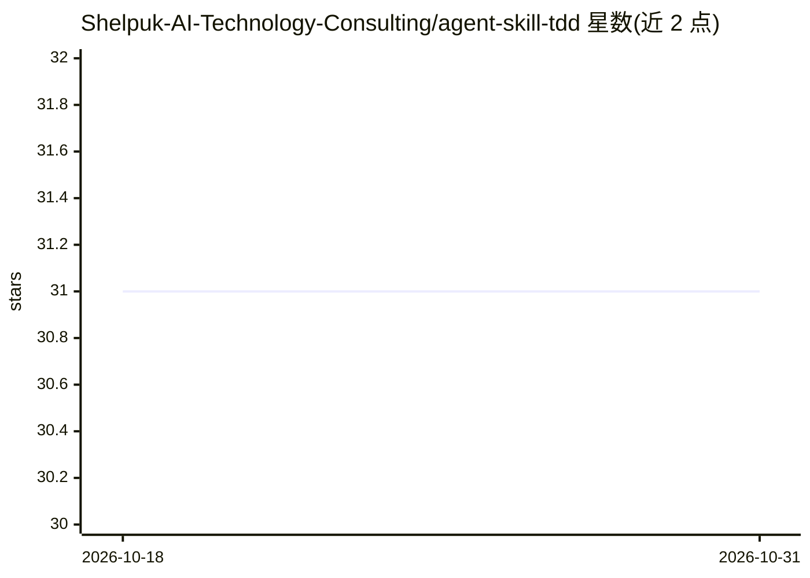

# Shelpuk-AI-Technology-Consulting/agent-skill-tdd

⭐ 31 · Python · MIT · 推送 2026-04-10 · [GitHub](https://github.com/Shelpuk-AI-Technology-Consulting/agent-skill-tdd) · [官网](https://www.shelpuk.com) · 组织维护

**面向 AI 编程代理的 TDD 与需求纪律技能（SKILL.md）**

一个由 SKILL.md 构成的 agent 技能，安装到 Codex 或 Claude Code 的 skills 目录后，指示代理对每个编码任务执行 6 步工作流：激活 Serena 做语义导航、先调查再改动、确认需求、写入 .requirements/<时间戳>_<功能名>/REQUIREMENTS.md、经 Lad MCP Server 做系统设计评审、最后按测试先行实现并逐次 code_review。属于 Shelpuk agentic 套件，依赖 Serena、Kindly Web Search、Lad 三个 MCP 服务器配合。提供 skill-installer 脚本与手动符号链接两种安装方式，附带 frontmatter 校验与单元测试。

## 筛选速览

| 维度 | 判定 | 备注 |
|---|---|---|
| AI 角色 | `ai-ecosystem` | LLM/agent 周边工具 |
| 许可风险 | `permissive` | MIT |
| 部署形态 | `None` |  |
| 模型依赖 | — | README 未给出锁定关系 |
| 硬件要求 | — | 无带数字的原话,不猜 |
| 安装摩擦 | `low` | 无编译、无系统依赖或容器化 |
| 成熟度 | — | 结构信号不足 |

## 能力要点

- 6 步工作流：调查→需求确认→REQUIREMENTS.md→设计评审→TDD 实现
- 每任务生成带时间戳的 REQUIREMENTS.md（As Is/To Be/验收标准等），不覆盖历史
- 兼容 Claude Code、Codex、Antigravity、Cursor、Windsurf 及任何支持 skills/MCP 的代理
- 与 Serena、Kindly Web Search、Lad MCP Server 组成套件协作

## 适用场景

- 让 Claude Code/Codex 等编程代理按 TDD 流程开发功能
- 在实现前固化需求文档与验收标准，避免代理静默解释需求
- 跨会话保留设计决策与调试记录

## 场景标签

`提示工程` · 领域:Agent 开发

## 证据(README 行号)

> L5: Works with **Claude Code**, **Codex**, **Antigravity**, **Cursor**, **Windsurf**, and any agent that supports skills
> L75: The `tdd` skill is a `SKILL.md` file that Codex and Claude Code discover automatically from `~/.codex/skills/tdd/` 

## 星数曲线

2026-10-18 31 → 2026-10-31 31（+0）

---
*卡片 v1 · prompt 1.4 · 生成 2026-10-26 · 置信度 high · 依据 README sha `a8b7fd15f61c` · [字段定义](../../DATASET.md)*
