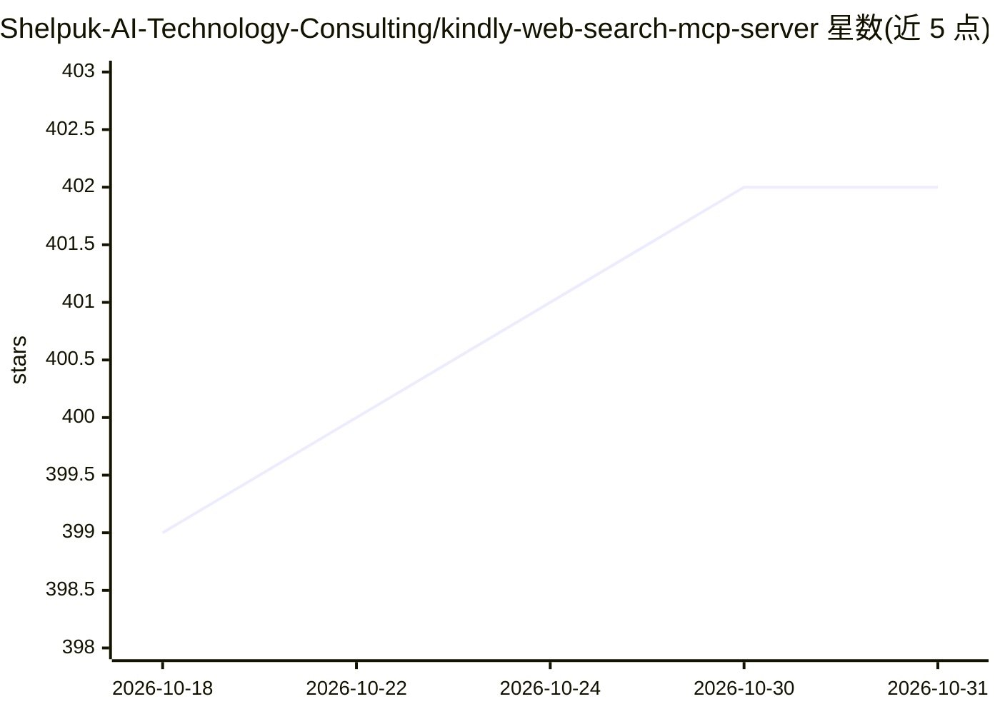

# Shelpuk-AI-Technology-Consulting/kindly-web-search-mcp-server

⭐ 402 · Python · MIT · 推送 2026-10-19 · [GitHub](https://github.com/Shelpuk-AI-Technology-Consulting/kindly-web-search-mcp-server) · [官网](https://www.shelpuk.com) · 组织维护 · 中文 README

**给 AI 编码工具的网页搜索+内容抓取 MCP 服务器**

面向 Claude Code、Codex、Cursor 等 AI 编码工具与 agent 的 MCP 服务器，提供 web_search 与 get_content 两个工具。核心机制是对 URL 走优先级处理链：StackExchange/GitHub Issues/Discussions/Wikipedia/arXiv 走专门 API 返回完整问答与评论，其余 URL 由无头 Chromium 抓取并转 Markdown，另有 markdown 快速路径跳过浏览器。搜索后端支持 Serper、SerpBase、Tavily、SearXNG、Sofya、You.com、Serply 按优先级回退。限制：需配置至少一个搜索 API key；通用网页抓取需本机装有 Chromium 系浏览器（否则仅专门源可用）；Python 3.13+。通过 uvx 从 git 运行，首次构建约 30-60 秒。

## 筛选速览

| 维度 | 判定 | 备注 |
|---|---|---|
| AI 角色 | `ai-ecosystem` | LLM/agent 周边工具 |
| 许可风险 | `permissive` | MIT |
| 部署形态 | `desktop` | 安装包/桌面程序 |
| 模型依赖 | — | README 未给出锁定关系 |
| 硬件要求 | — | 无带数字的原话,不猜 |
| 安装摩擦 | `low` | 无编译、无系统依赖或容器化 |
| 成熟度 | — | 结构信号不足 |

## 能力要点

- 对 StackExchange/GitHub Issues/Wikipedia/arXiv 走专门 API，单次调用返回完整问答、评论与元数据
- 任意网页用无头 Chromium（nodriver）实时解析并转 Markdown，免去二次抓取
- 7 种搜索后端按优先级智能回退
- httpx 处理链支持 HTTP/SOCKS5 代理环境变量，文档站可走 {path}.md 快速路径跳过浏览器

## 适用场景

- 让 Claude Code/Codex 等编码助手调试时直接拿到 StackOverflow/GitHub Issue 的完整讨论内容
- AI agent 检索最新 API 与包文档
- 通过 SearXNG 自托管搜索后端避免商业 API 依赖

## 场景标签

`网页抓取` · 领域:效率与自动化

## 证据(README 行号)

> L7: Works with **Claude Code**, **Codex**, **Antigravity**, **Cursor**, **Windsurf**, and any agent that supports skills
> L67: ✅ **Integrates directly with APIs** for StackExchange, GitHub Issues, arXiv, and Wikipedia - presenting content in 
> L97: - `web_search(query, num_results=3)` → top results with `title`, `link`, `snippet`, and `page_content` (Markdown, b

## 星数曲线

2026-10-18 399 → 2026-10-31 402（+3）

---
*卡片 v1 · prompt 1.4 · 生成 2026-10-21 · 置信度 mid · 依据 README sha `a47ea5c55da1` · [字段定义](../../DATASET.md)*
