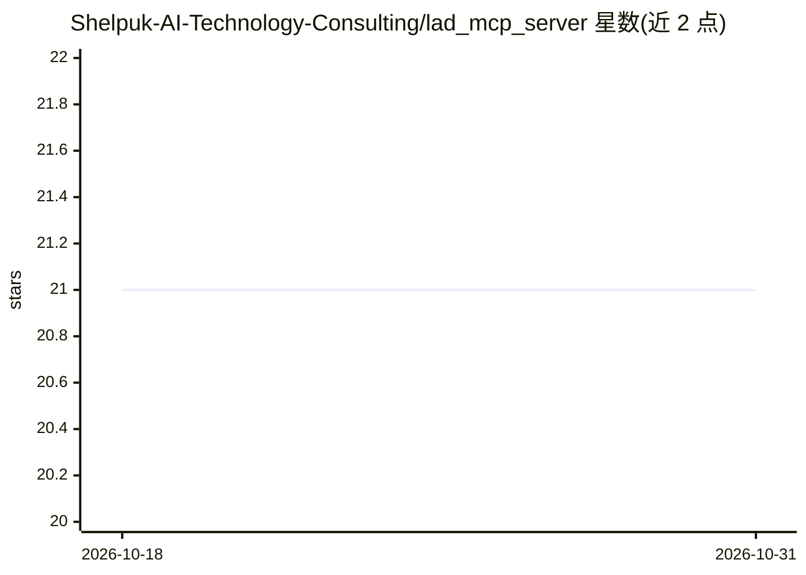

# Shelpuk-AI-Technology-Consulting/lad_mcp_server

⭐ 21 · Python · MIT · 推送 2026-08-11 · [GitHub](https://github.com/Shelpuk-AI-Technology-Consulting/lad_mcp_server) · [官网](https://www.shelpuk.com) · 组织维护

**面向 AI 编程 agent 的项目感知代码与系统设计评审 MCP 服务器**

Shelpuk AI Technology Consulting 开源的 MCP 服务器，为 Claude Code、Codex、Cursor 等 AI 编程 agent 提供第二双眼睛式的代码评审。暴露 code_review 与 system_design_review 两个工具，默认并行运行双评审模型并输出综合摘要；模型经 OpenRouter 网关自动获取元数据（零配置），也可配置直接端点。可选集成 Serena 获取项目索引与持久记忆，实现结合项目历史与设计决策的评审；无 Serena 时仅基于提交的代码评审。以 Python 实现，经 uvx 通过 stdio 运行，需 OpenRouter API key 等凭据，Python 3.11+。

## 筛选速览

| 维度 | 判定 | 备注 |
|---|---|---|
| AI 角色 | `ai-ecosystem` | LLM/agent 周边工具 |
| 许可风险 | `permissive` | MIT |
| 部署形态 | `self-host` | docker 或自建部署 |
| 模型依赖 | locked-api |  |
| 硬件要求 | — | 无带数字的原话,不猜 |
| 安装摩擦 | `low` | 无编译、无系统依赖或容器化 |
| 成熟度 | — | 结构信号不足 |

## 能力要点

- code_review 与 system_design_review 两个 MCP 工具，支持文本与文件路径输入
- 默认双评审模型并行并返回综合摘要，可切换单评审模式
- OpenRouter 零配置：自动从 API 获取模型上下文窗口等元数据
- 可选 Serena 集成，接入项目索引与跨会话记忆做项目感知评审

## 适用场景

- 让 AI 编程 agent 产出的代码在合入前获得第二个模型评审
- 对照项目历史设计决策检查架构提案与系统设计
- 在 Claude Code/Codex/Cursor 等 MCP 客户端中以 stdio 方式接入评审服务

## 场景标签

`代码审查` · 领域:编码与开发

## 证据(README 行号)

> L7: Works with **Claude Code**, **Codex**, **Antigravity**, **Cursor**, **Windsurf**, and any agent that supports skills
> L164: Lad exposes two MCP tools:
> L169: Each tool runs **two reviewers in parallel** (Primary + Secondary) and returns both outputs plus a synthesized sum

## 星数曲线

2026-10-18 21 → 2026-10-31 21（+0）

---
*卡片 v1 · prompt 1.4 · 生成 2026-10-28 · 置信度 mid · 依据 README sha `3153a6b7f950` · [字段定义](../../DATASET.md)*
