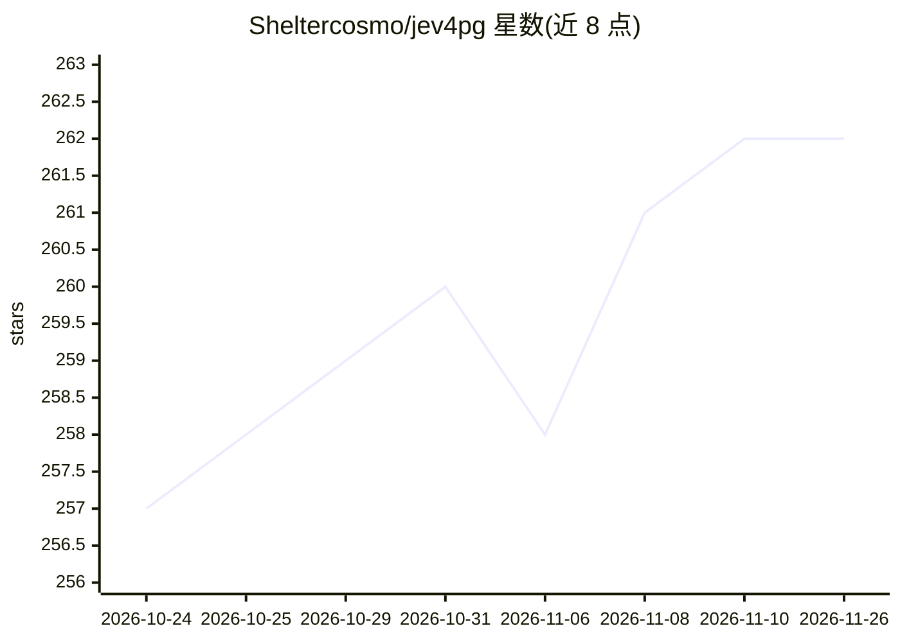

# Sheltercosmo/jev4pg

⭐ 262 · Python · Apache-2.0 · 推送 2026-10-26 · [GitHub](https://github.com/Sheltercosmo/jev4pg) · [官网](https://jev4pg.com) · 个人维护 · 中文 README

**为 PostgreSQL 提供自然语言转 SQL 与语义算子的扩展**

为 PostgreSQL 14–17 提供 41 个 JEV 语义算子（过滤、抽取、排序、匹配、验证），支持英文与简体中文自然语言查询。提供三种部署形态：Python 应用（工作区、HTTP API、语义 SQL）、Linux 上的原生 Rust 扩展（CREATE EXTENSION jev_native）及组合部署。机制包括证据缓存与复用、独立判断并行调度、可解释的概率嵌入（以命名问题与答案概率表达相似度）、VALUE/UNKNOWN/NOT_EVALUATED 决策状态区分与可复核回退。Apache 2.0 许可，Release 0.8.0。

## 筛选速览

| 维度 | 判定 | 备注 |
|---|---|---|
| AI 角色 | `ai-native` | 本体是模型或模型工具 |
| 许可风险 | `permissive` | Apache-2.0 |
| 部署形态 | `self-host` | docker 或自建部署 |
| 模型依赖 | — | README 未给出锁定关系 |
| 硬件要求 | — | 无带数字的原话,不猜 |
| 安装摩擦 | `low` | 无编译、无系统依赖或容器化 |
| 成熟度 | `idea` | |

## 能力要点

- 41 个 JEV 语义算子覆盖过滤、抽取、排序、匹配与验证
- 证据缓存与跨连接复用，阈值变更时无需重新推理
- 原生 Rust 扩展支持并行阶段计划与上下文去重
- 概率嵌入以命名问题表达相似度，可逐项检查

## 适用场景

- 在现有 PostgreSQL 数据上构建语义搜索
- 用自然语言查询工单/评论等文本数据集
- 为团队构建可复用、可版本化的语义特征层
- 需要保留不确定判断并路由人工复核的分析流程

## 场景标签

`数据分析` `语义搜索` · 领域:效率与自动化

## 证据(README 行号)

> L25: jev4pg brings semantic intelligence to PostgreSQL 14–17 with **41 JEV operators** for filtering, extraction, rankin
> L102: |**Python application**|Natural-language queries, the web workspace, HTTP APIs, all 41 operators, reviewed feature
> L103: |**Native Rust extension**|Synchronous semantic SQL, parallel stage plans, repeated-context reuse and explainable 

## 星数曲线

2026-10-24 257 → 2026-11-26 262（+5）

---
*卡片 v1 · prompt 1.4 · 生成 2026-11-25 · 置信度 high · 依据 README sha `38fe2e273d1f` · [字段定义](../../DATASET.md)*
