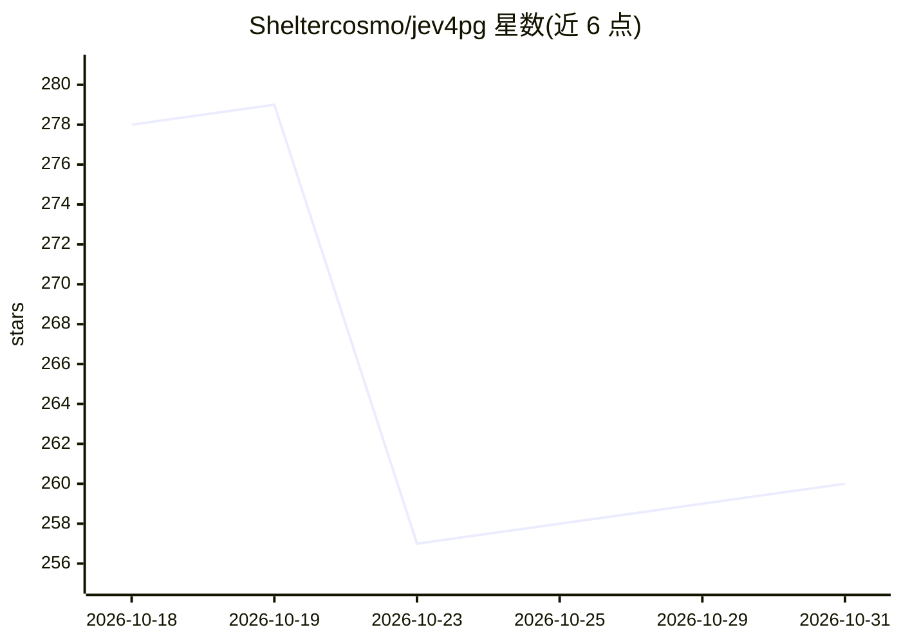

# Sheltercosmo/jev4pg

⭐ 260 · Python · Apache-2.0 · 推送 2026-10-26 · [GitHub](https://github.com/Sheltercosmo/jev4pg) · [官网](https://jev4pg.com) · 个人维护 · 中文 README

**面向 PostgreSQL 的自然语言转 SQL 与语义算子工具**

提供两种形态：Python 应用（v0.7.0，含 Web 工作区、CSV 导入、NL2SQL、查询历史、后台任务）与 Rust 编写的 PostgreSQL 原生扩展（0.2.0 预览，jev_native.* 函数在库内执行语义分析）。核心是 41 个 JEV 算子，支持语义过滤、抽取、排序、匹配与验证，通过可解释嵌入（命名问题与答案概率）表示数据；带证据缓存、受控重试与可审查回退。支持英语与简体中文查询，可连接既有 PostgreSQL 17 数据库就地读取。原生版本首次构建需编译 Rust，语义调用依赖 JEV 提供商 key。

## 筛选速览

| 维度 | 判定 | 备注 |
|---|---|---|
| AI 角色 | `ai-native` | 本体是模型或模型工具 |
| 许可风险 | `permissive` | Apache-2.0 |
| 部署形态 | `self-host` | docker 或自建部署 |
| 模型依赖 | — | README 未给出锁定关系 |
| 硬件要求 | — | 无带数字的原话,不猜 |
| 安装摩擦 | `low` | 无编译、无系统依赖或容器化 |
| 成熟度 | `idea` | |

## 能力要点

- 41 个 JEV 语义算子（过滤/抽取/排序/匹配/验证），SEMANTIC 等 SQL 语法
- 可解释嵌入：以命名问题与答案概率表示相似性
- Rust 原生 PostgreSQL 扩展支持并行执行与输入去重
- 证据缓存、可审查回退与自发展语义层，不确定性显式保留

## 适用场景

- 在既有 PostgreSQL 数据上用自然语言做分析查询
- 对工单、文档等文本字段做语义过滤与统计（如 SEMANTIC WHERE 子句）
- 通过 psql 或 SQL 客户端直接调用 jev_native.scan 做语义分析
- 导入 CSV/TSV 数据集并复用审校过的语义定义

## 场景标签

`数据分析` `语义搜索` · 领域:效率与自动化

## 证据(README 行号)

> L23: jev4pg is a carefully designed JEV harness, brings semantic intelligence to PostgreSQL with a comprehensive toolkit
> L80: WHERE SEMANTIC(body, 'The ticket describes an unresolved billing problem.')

## 星数曲线

2026-10-18 278 → 2026-10-31 260（-18）

---
*卡片 v1 · prompt 1.4 · 生成 2026-10-22 · 置信度 high · 依据 README sha `c49256dbf5c1` · [字段定义](../../DATASET.md)*
