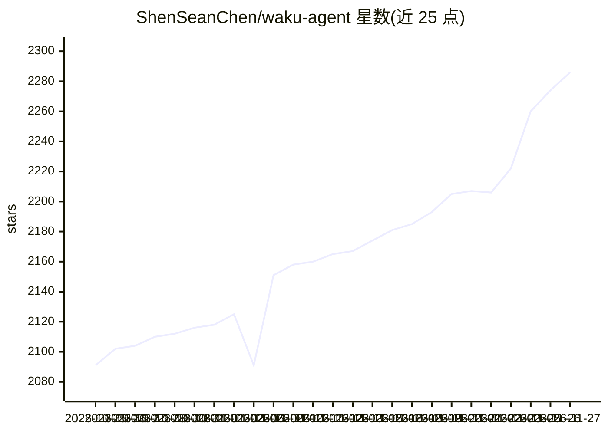

# ShenSeanChen/waku-agent

⭐ 2,286 · Python · MIT · 推送 2026-11-26 · [GitHub](https://github.com/ShenSeanChen/waku-agent) · [官网](waku.one) · 个人维护 · 中文 README

**本地优先、可读源码的个人 AI 助手框架**

以约 95 行 Python 循环为核心的本地优先个人助理代码库，展示 Harness、Loop、Memory、Eval/LLM-Ops、Always-on 五个组成部分。记忆为单个 SQLite 文件，分语义/情景/程序性三类并带写入门槛与整合；内置确定性测试与 LLM-as-judge 双路评测及发布门；事件先落盘的事件收件箱、定时器、审批与发件箱构成常驻层，通过 waku serve 响应 Telegram、Slack、GitHub 与定时器。面向想阅读和修改 agent 代码的开发者，另提供邀请制托管实例。

## 筛选速览

| 维度 | 判定 | 备注 |
|---|---|---|
| AI 角色 | `ai-native` | 本体是模型或模型工具 |
| 许可风险 | `permissive` | MIT |
| 部署形态 | `library` | 以包/库形式分发 |
| 模型依赖 | locked-api |  |
| 硬件要求 | — | 无带数字的原话,不猜 |
| 安装摩擦 | `low` | 无编译、无系统依赖或容器化 |
| 成熟度 | — | 结构信号不足 |

## 能力要点

- ~95 行 Python 的主循环与可本地阅读的代码结构
- 语义+情景+程序性三类记忆，含是否记忆门槛与整合流程，存储为单个 SQLite 文件
- 内置确定性测试与 LLM-as-judge 双评测及发布门
- Always-on 层：事件收件箱、定时器、审批暂停、outbox，事件先落盘

## 适用场景

- 在本地终端或浏览器面板与自己的个人助理对话
- 让助理跨会话记住偏好并据此安排日程
- 为团队搭建共享记忆的常驻助理（Slack 频道应答、提醒与日报）
- 作为学习 agent 循环、记忆与评测机制的参考代码库

## 场景标签

`Agent 框架` `AI 助手` `模型评测` · 领域:Agent 开发

## 证据(README 行号)

> L5: **Your own AI assistant. On your laptop. In code you can read in an afternoon.**
> L8: serious agent: **Harness · Loop · Memory · Eval/LLM-Ops · Always-on**. No frameworks hiding the good parts.
> L79: **Use the model you already pay for.** Anthropic (default), OpenAI, Gemini, DeepSeek, MiniMax,

## 星数曲线

2026-10-25 2,091 → 2026-11-27 2,286（+195）

---
*卡片 v1 · prompt 1.4 · 生成 2026-11-24 · 置信度 high · 依据 README sha `e3e690c2345f` · [字段定义](../../DATASET.md)*
