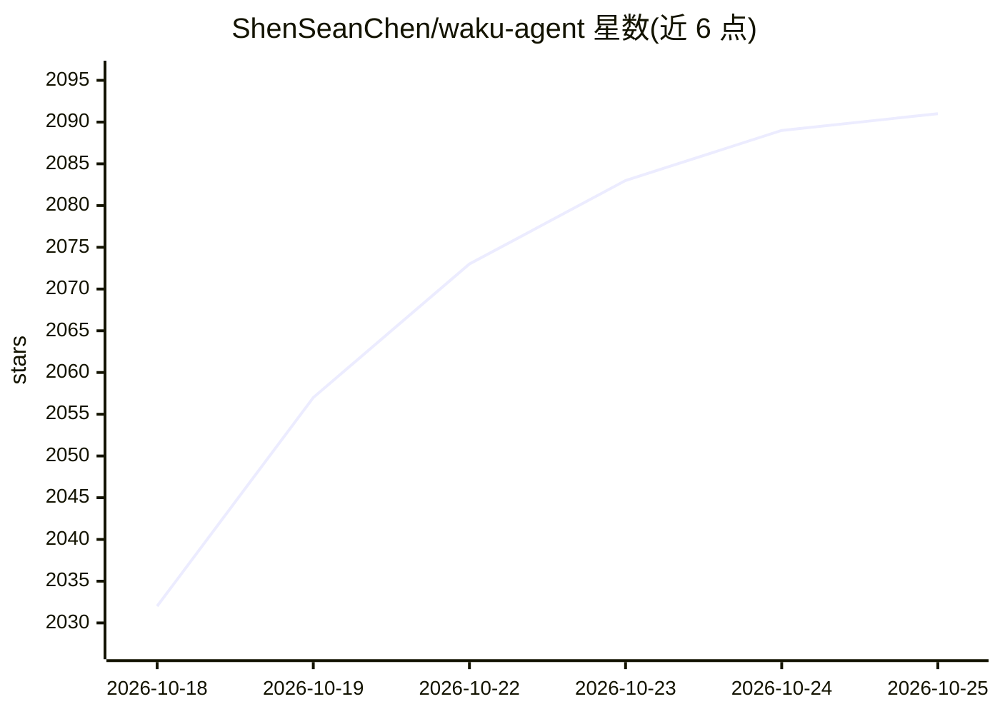

# ShenSeanChen/waku-agent

⭐ 2,091 · Python · MIT · 推送 2026-10-23 · [GitHub](https://github.com/ShenSeanChen/waku-agent) · [官网](waku.one) · 个人维护 · 中文 README

**本地优先的个人 AI agent 框架，附记忆/评测与终端/网页界面**

面向个人的本地 AI 助手 harness，强调代码可读可改：约 95 行 Python 的 agent loop、SQLite 单文件的三类记忆（语义/情景/程序性，含记忆门控与巩固）、确定性测试+LLM-as-judge 评测与发布门控，并通过终端、浏览器 dashboard（localhost:7777）及 Telegram/Discord/WhatsApp 等网关交互。支持 Anthropic（默认）、OpenAI、Gemini、DeepSeek、OpenRouter 等多家模型提供商（约 60 行适配层）。核心 MIT 许可，hosted/ 目录为 Elastic License 2.0。

## 筛选速览

| 维度 | 判定 | 备注 |
|---|---|---|
| AI 角色 | `ai-native` | 本体是模型或模型工具 |
| 许可风险 | `permissive` | MIT |
| 部署形态 | `library` | 以包/库形式分发 |
| 模型依赖 | locked-api |  |
| 硬件要求 | — | 无带数字的原话,不猜 |
| 安装摩擦 | `low` | 无编译、无系统依赖或容器化 |
| 成熟度 | — | 结构信号不足 |

## 能力要点

- 约 95 行 Python 的 agent loop，代码可读可改
- SQLite 单文件本地记忆，含语义/情景/程序性三类与记忆门控
- 内置确定性测试与 LLM-as-judge 双轨评测及发布门控
- 多提供商适配（Anthropic/OpenAI/Gemini/DeepSeek/OpenRouter 等）

## 适用场景

- 在本机运行并拥有一个可读源码的个人 AI 助手
- 通过 dashboard 观察消息在 harness 中的流转
- 把同一份记忆连接到 Claude Code、Codex 等其他 agent

## 场景标签

`Agent 框架` `AI 助手` `Agent 记忆` · 领域:Agent 开发

## 证据(README 行号)

> L7: Meet **Waku** — a local-first personal assistant that shows the four pillars behind every
> L8: serious agent: **Harness · Loop · Memory · Eval/LLM-Ops**. No frameworks hiding the good parts.
> L57: **Use the model you already pay for.** Anthropic (default), OpenAI, Gemini, DeepSeek, MiniMax,
> L58: Kimi, GLM, OpenRouter (one key, hundreds of hosted models), OpenCode Zen, or OpenCode Go —

## 星数曲线

2026-10-18 2,032 → 2026-10-25 2,091（+59）

---
*卡片 v1 · prompt 1.4 · 生成 2026-10-21 · 置信度 high · 依据 README sha `49d24bb08c18` · [字段定义](../../DATASET.md)*
