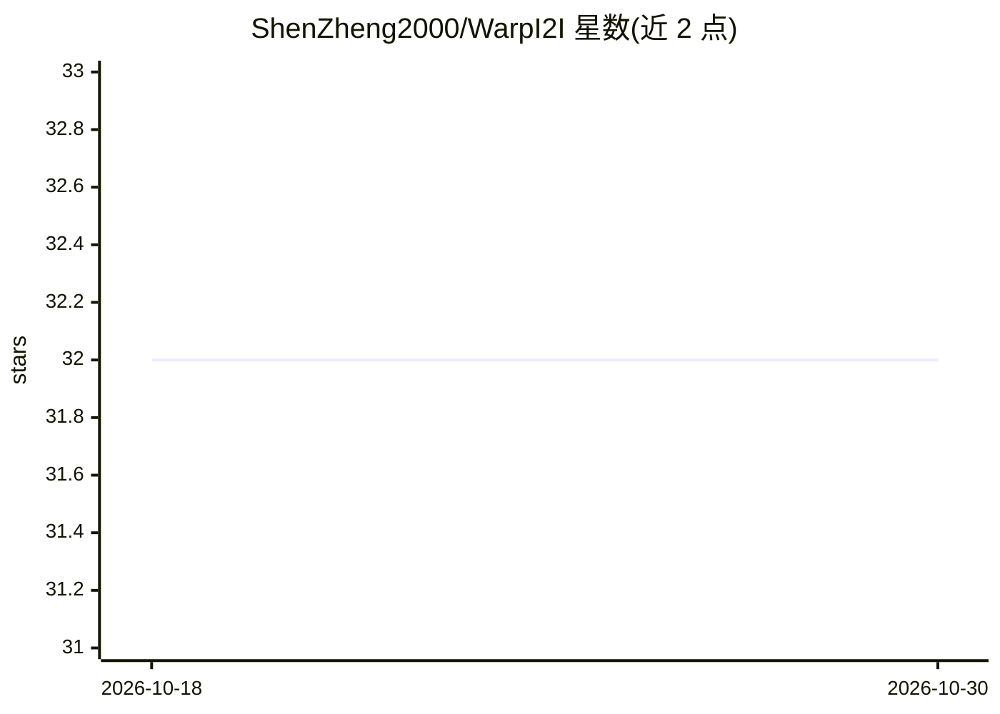

# ShenZheng2000/WarpI2I

⭐ 32 · Python · MIT · 推送 2026-09-26 · [GitHub](https://github.com/ShenZheng2000/WarpI2I) · 组织维护

**CMU 论文项目：图像扭曲改善图到图翻译的细节保留**

ECCV 2026 论文（Shen Zheng 等，卡内基梅隆大学）的官方代码：在图像到图翻译前对输入图像做扭曲（warp），放大图像中的显著小区域（物体、人脸、眼睛等），以在压缩潜空间中更好保留细节；翻译后做反扭曲。方法与模型架构无关，额外延迟 0.006 秒、零额外可学参数，代码在 Pix2Pix-Turbo 与 CycleGAN-Turbo 训练脚本中集成。提供 HuggingFace 在线 Demo（人像重光照、驾驶重光照、驾驶域迁移）与模型权重，本地安装与训练细节见 docs/ 目录。

## 筛选速览

| 维度 | 判定 | 备注 |
|---|---|---|
| AI 角色 | `ai-native` | 本体是模型或模型工具 |
| 许可风险 | `permissive` | MIT |
| 部署形态 | `library` | 以包/库形式分发 |
| 模型依赖 | — | README 未给出锁定关系 |
| 硬件要求 | — | 无带数字的原话,不猜 |
| 安装摩擦 | `low` | 无编译、无系统依赖或容器化 |
| 成熟度 | — | 结构信号不足 |

## 能力要点

- 扭曲-反扭曲机制放大显著小区域以保留细节
- 模型无关：无需修改架构，零额外可学参数、0.006s 额外延迟
- 集成于 Pix2Pix-Turbo 与 CycleGAN-Turbo 训练流程
- HuggingFace 在线 Demo 覆盖重光照与域迁移任务

## 适用场景

- 我想在人像重光照任务中保留眼睛等细节
- 驾驶场景做白天转黑夜、晴天转雨天等域迁移
- 在我的潜空间扩散翻译模型中集成扭曲预处理

## 场景标签

`图像生成` · 领域:内容生成

## 证据(README 行号)

> L23: We warp the input image to enlarge small salient regions (e.g., objects, faces, eyes) to better preserve fine detai
> L27: * **Model-agnostic** — no architectural modifications needed.

## 星数曲线

2026-10-18 32 → 2026-10-30 32（+0）

---
*卡片 v1 · prompt 1.4 · 生成 2026-10-26 · 置信度 high · 依据 README sha `b3336fd71fcb` · [字段定义](../../DATASET.md)*
