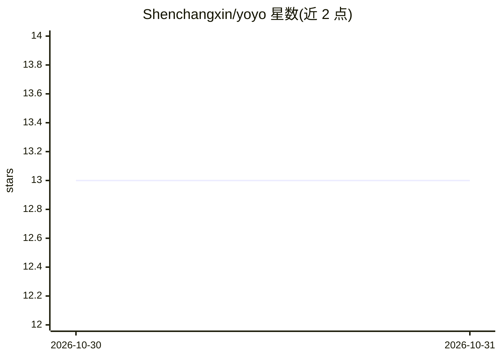

# Shenchangxin/yoyo

⭐ 13 · Go · Apache-2.0 · 推送 2026-10-30 · [GitHub](https://github.com/Shenchangxin/yoyo) · [官网](https://shenchangxin.github.io/yoyo/) · 个人维护 · 中文 README

**本地 Agent 工作站：桌面/浏览器/CLI 多入口编辑代码与生成短视频**

开源本地 Agent 工作站，桌面端为 Go + Wails v3，同一循环提供四种入口：桌面窗口、本机浏览器 UI、CLI 与局域网手机客户端。功能包括：在用户指定文件夹内编辑代码并按 hunk 审查 diff、写/Shell 命令先请求批准、USD 预算硬停、隔离 Chrome 打开工作区页面、Create/Shorts/Drama/Canvas 四条视频流水线、按需启用的第三方技能包，以及基于 BLAKE3 内容寻址 CAS 的 harness 自我精炼（须通过 Harbor 评估后人工切换生效）。模型由用户接入 OpenAI 兼容服务，密钥存本地 vault；评估器、vault 与更新器在 Agent 可改范围之外。Apache-2.0，Windows/macOS/Linux 提供安装包，Android 提供 APK。

## 筛选速览

| 维度 | 判定 | 备注 |
|---|---|---|
| AI 角色 | `ai-native` | 本体是模型或模型工具 |
| 许可风险 | `permissive` | Apache-2.0 |
| 部署形态 | `desktop` | 安装包/桌面程序 |
| 模型依赖 | — | README 未给出锁定关系 |
| 硬件要求 | — | 无带数字的原话,不猜 |
| 安装摩擦 | `low` | 无编译、无系统依赖或容器化 |
| 成熟度 | — | 结构信号不足 |

## 能力要点

- 一个 Go 循环四个入口：桌面、本机浏览器、CLI、局域网手机
- harness 内容寻址（BLAKE3 CAS），自我精炼候选须通过 Harbor 评估并由用户手动切换生效
- 写与 Shell 命令分级审批，USD 预算硬停，diff 按 hunk 审查
- Create/Shorts/Drama/Canvas 四条短视频生成流水线，独立文件夹与独立会话

## 适用场景

- 在自己电脑上运行会写代码、能审查每次改动的 Agent，数据不出本机
- 文字转短视频：选题成片、章节转剧情、分镜画布
- 在终端用 CLI 跑单轮任务或管理技能包
- 手机与电脑同局域网配对，手机上操作电脑上的 Agent

## 场景标签

`编码 Agent` `视频生成` · 领域:编码与开发

## 证据(README 行号)

> L19: Yoyo is an open-source local agent workstation. The desktop app is Go with a Wails v3 window. It edits code in a fo
> L26: 2. ✨ A streaming agent. `@file`, `@folder`, `@harness`, and `@skill` name the context. One `@` injects only what yo
> L196: Shorts, Drama, and Canvas generate. **Send to finish** hands the clip to the existing cut. On the Chinese UI that 

## 星数曲线

2026-10-30 13 → 2026-10-31 13（+0）

---
*卡片 v1 · prompt 1.4 · 生成 2026-10-31 · 置信度 mid · 依据 README sha `2ba2adbbd937` · [字段定义](../../DATASET.md)*
