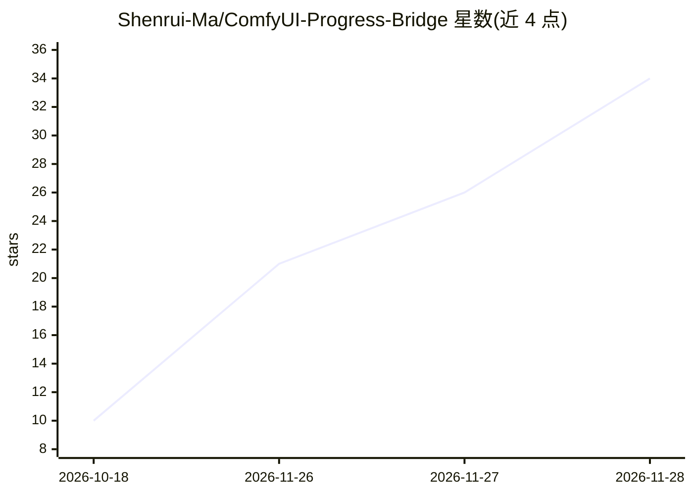

# Shenrui-Ma/ComfyUI-Progress-Bridge

⭐ 34 · Python · MIT · 推送 2026-09-05 · [GitHub](https://github.com/Shenrui-Ma/ComfyUI-Progress-Bridge) · 个人维护 · 中文 README

**ComfyUI 执行进度监控桥：多端点面板+UDP 镜像+完成提醒**

以 ComfyUI custom-node 形式安装的服务器扩展，不修改工作流、不添加图节点，通过包装 PromptServer.send_sync 获取执行事件，镜像到浏览器面板、PyQt6 桌面停靠窗与 UDP 127.0.0.1:30999（schema v2，8192 字节上限，白名单字段，不含提示词/图像等媒体）。支持同时监控多个本地与 SSH 远端 ComfyUI 进程，队列清空时触发 Telegram/微信/QQ 通知（默认关闭）。隐私设计为仅回环地址、无账号与遥测。

## 筛选速览

| 维度 | 判定 | 备注 |
|---|---|---|
| AI 角色 | `ai-ecosystem` | LLM/agent 周边工具 |
| 许可风险 | `permissive` | MIT |
| 部署形态 | `library` | 以包/库形式分发 |
| 模型依赖 | — | README 未给出锁定关系 |
| 硬件要求 | — | 无带数字的原话,不猜 |
| 安装摩擦 | `low` | 无编译、无系统依赖或容器化 |
| 成熟度 | — | 结构信号不足 |

## 能力要点

- 导入时服务器扩展，无需改动工作流，幂等包装 send_sync
- UDP schema v2 镜像执行事件，数据字段白名单且不含生成媒体
- PyQt6 桌面窗支持多端点、SSH 远端探测、四语言 UI
- 队列完成时可选 Telegram/微信/ServerChan 后端通知

## 适用场景

- 同时盯着本地和多台远程 ComfyUI 的出图进度
- 跑长任务时离开电脑，队列跑完收到手机通知
- 无桌面的服务器上禁用原生猪圈，仅保留面板与 UDP

## 场景标签

 · 领域:AI 图像生成工具链/监控

## 证据(README 行号)

> L10: Lightweight, privacy-first ComfyUI progress monitoring with a browser panel, optional desktop dock,
> L25: |ComfyUI integration|Import-time server extension, no graph nodes, no workflow mutation, idempotent `PromptServer.s
> L95: Backend notifications are part of this plugin. They do not require an agent framework, LLM,

## 星数曲线

2026-10-18 10 → 2026-11-28 34（+24）

---
*卡片 v1 · prompt 1.4 · 生成 2026-11-26 · 置信度 mid · 依据 README sha `48fefa200c91` · [字段定义](../../DATASET.md)*
