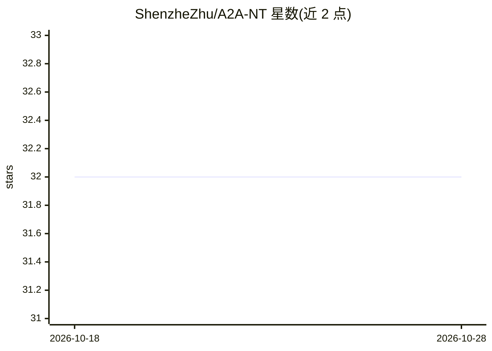

# ShenzheZhu/A2A-NT

⭐ 32 · Python · 推送 2026-06-09 · [GitHub](https://github.com/ShenzheZhu/A2A-NT) · [官网](https://arxiv.org/abs/2506.00073) · 组织维护

**面向研究者的 LLM 代理间消费市场谈判与交易基准**

A2A-NT 模拟消费市场场景：买卖双方均将价格谈判委托给 LLM 代理执行，基准记录完整对话轨迹、提取的卖方报价、成交结果、预算与批发价约束及运行后异常标注。模型调用经 LiteLLM 路由，支持 OpenRouter 后端，实验由产品文件、买/卖/摘要模型、预算场景与轮次上限定义。后处理将异常分为模型行为、诊断、系统数据三类，干净成交指标排除不安全行为结果。提供 sweep 运行、摘要 CLI 与结果目录结构，需 Python 3.9 环境并配置 API key。

## 筛选速览

| 维度 | 判定 | 备注 |
|---|---|---|
| AI 角色 | `ai-ecosystem` | LLM/agent 周边工具 |
| 许可风险 | `none` | — |
| 部署形态 | `library` | 以包/库形式分发 |
| 模型依赖 | — | README 未给出锁定关系 |
| 硬件要求 | — | 无带数字的原话,不猜 |
| 安装摩擦 | `low` | 无编译、无系统依赖或容器化 |
| 成熟度 | — | 结构信号不足 |

## 能力要点

- 买卖双方 LLM 代理的价格谈判模拟与全轨迹记录
- 三级异常分类：model_behavior_flags / diagnostic_flags / system_data_flags
- 预算场景（low/wholesale/mid/retail/high）压力测试
- 摘要 CLI 生成 pair 级结果、买卖双方排行榜与风险率

## 适用场景

- 评测不同 LLM 在代理谈判中的定价与风险行为
- 分析代理交易中的超付、违约、死锁等异常
- 对比候选摘要模型的报价提取与状态判定

## 场景标签

`模型评测` · 领域:评测与运维

## 证据(README 行号)

> L15: A2A-NT simulates consumer-market negotiations where both buyers and sellers delegate price negotiation to LLM agent
> L216: @misc{zhu2025automatedriskygamemodeling,

## 星数曲线

2026-10-18 32 → 2026-10-28 32（+0）

---
*卡片 v1 · prompt 1.4 · 生成 2026-10-26 · 置信度 mid · 依据 README sha `be186a743d53` · [字段定义](../../DATASET.md)*
