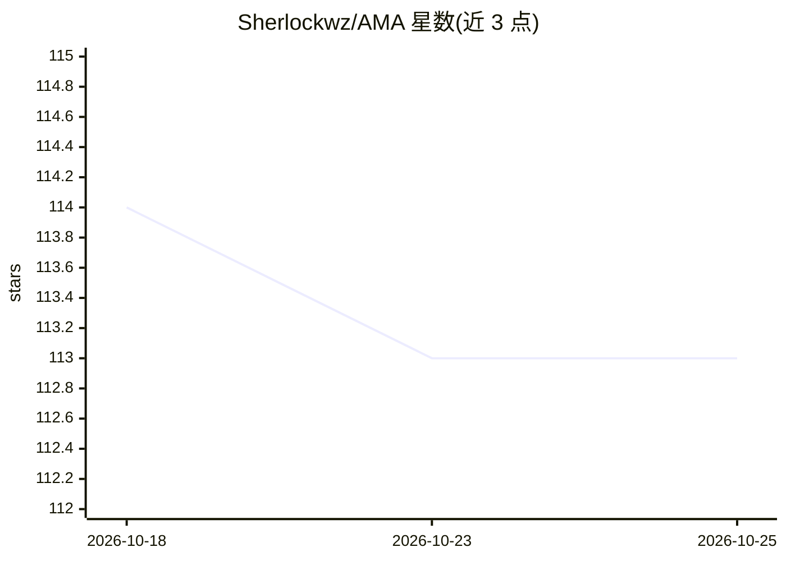

# Sherlockwz/AMA

⭐ 113 · Python · Apache-2.0 · 推送 2026-09-08 · [GitHub](https://github.com/Sherlockwz/AMA) · [官网](https://sherlockwz.github.io/AMA/) · 组织维护 · 中文 README

**多智能体协作的自适应长期记忆框架，附可复用 agent 记忆技能**

ACL 2026 论文 AMA 的官方代码库：通过 Constructor/Retriever/Judge/Refresher 四个协作 agent 与原文、事实、事件三种记忆粒度，实现记忆的构建、检索、校验与更新维护。提供两条使用路径：Python 研究复现实现（含 LoCoMo 与 LongMemEval 评测）与面向 agent 框架的可移植记忆技能（SKILL.md），并附带 OpenClaw 参考适配器（SQLite/FAISS sidecar）。需 OpenAI 兼容的 chat-completions 与 embedding 端点。

## 筛选速览

| 维度 | 判定 | 备注 |
|---|---|---|
| AI 角色 | `ai-ecosystem` | LLM/agent 周边工具 |
| 许可风险 | `permissive` | Apache-2.0 |
| 部署形态 | `None` |  |
| 模型依赖 | — | README 未给出锁定关系 |
| 硬件要求 | — | 无带数字的原话,不猜 |
| 安装摩擦 | `low` | 无编译、无系统依赖或容器化 |
| 成熟度 | — | 结构信号不足 |

## 能力要点

- 四 agent 协作 + 三种记忆粒度的记忆生命周期管理
- Python 研究参考实现与 LoCoMo/LongMemEval 评测代码
- SKILL.md 形式的可移植 harness agent 记忆技能
- OpenClaw 参考适配器：自动 recall/capture 钩子 + SQLite/FAISS sidecar

## 适用场景

- 为我的 agent 框架接入长期记忆行为
- 复现论文的 LoCoMo / LongMemEval 实验
- 研究多粒度记忆的检索、校验与更新机制

## 场景标签

`Agent 记忆` `多智能体` · 领域:Agent 开发

## 证据(README 行号)

> L10:  Official code and reusable memory skills for AMA (Findings of ACL 2026).
> L61: |**Harness Agent memory skill**|Add AMA-style long-term memory behavior to an agent harness; use the included OpenC

## 星数曲线

2026-10-18 114 → 2026-10-25 113（-1）

---
*卡片 v1 · prompt 1.4 · 生成 2026-10-23 · 置信度 high · 依据 README sha `bf5ca7149433` · [字段定义](../../DATASET.md)*
