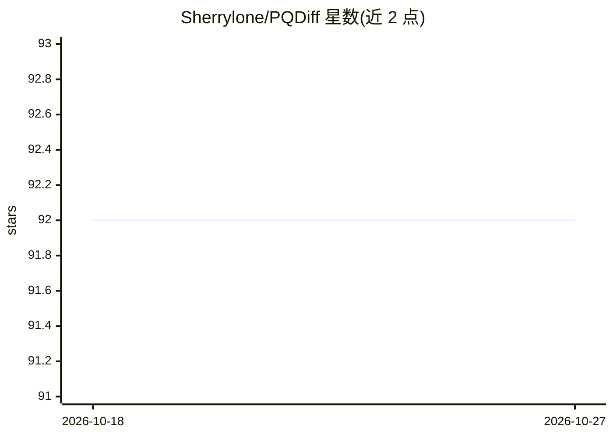

# Sherrylone/PQDiff

⭐ 92 · Python · 推送 2026-01-06 · [GitHub](https://github.com/Sherrylone/PQDiff) · 组织维护

**ICLR 2024 论文官方实现：单步任意倍率图像外扩生成**

PQDiff 是论文 Continuous-Multiple Image Outpainting in One-Step via Positional Query and A Diffusion-based Approach（ICLR 2024）的代码实现。模型通过同时学习位置关系与像素信息，在单步内完成任意连续倍率的图像外扩（outpainting），提供 2.25x、5x、11.7x 采样设置，可通过 target_expansion 参数指定上下左右扩边比例。训练使用 Flickr、Buildings、WikiArt 数据集与 Stable Diffusion 转换的 autoencoder，基于 accelerate 与 torch.distributed 的多 GPU 分布式脚本运行。模型检查点多数标注 TBD。

## 筛选速览

| 维度 | 判定 | 备注 |
|---|---|---|
| AI 角色 | `ai-native` | 本体是模型或模型工具 |
| 许可风险 | `none` | — |
| 部署形态 | `None` |  |
| 模型依赖 | — | README 未给出锁定关系 |
| 硬件要求 | — | 无带数字的原话,不猜 |
| 安装摩擦 | `low` | 无编译、无系统依赖或容器化 |
| 成熟度 | — | 结构信号不足 |

## 能力要点

- 单步完成任意连续倍率图像外扩
- target_expansion 四参数控制上/下/左/右扩边
- 提供 inception、FID、Centered PSNR 评估脚本
- 基于 Stable Diffusion 转换的 autoencoder 进行潜空间扩散

## 适用场景

- 按任意倍率扩展图像边界生成新内容
- 复现 ICLR 2024 论文的训练与评估流程
- 在自建数据集上训练图像外扩模型

## 场景标签

`图像生成` · 领域:内容生成

## 证据(README 行号)

> L16: Our PQDiff can outpaint images with arbitrary and continuous multiples in one step by learning the positional relat
> L38: accelerate launch --multi_gpu --num_processes 8 --mixed_precision fp16 train_ldm.py --config=configs/flickr192_larg
> L70: Methodically, PQDiff can outpaint at any multiple in only one step, greatly increasing the applicability of image o

## 星数曲线

2026-10-18 92 → 2026-10-27 92（+0）

---
*卡片 v1 · prompt 1.4 · 生成 2026-10-23 · 置信度 high · 依据 README sha `3bc45d58b41d` · [字段定义](../../DATASET.md)*
