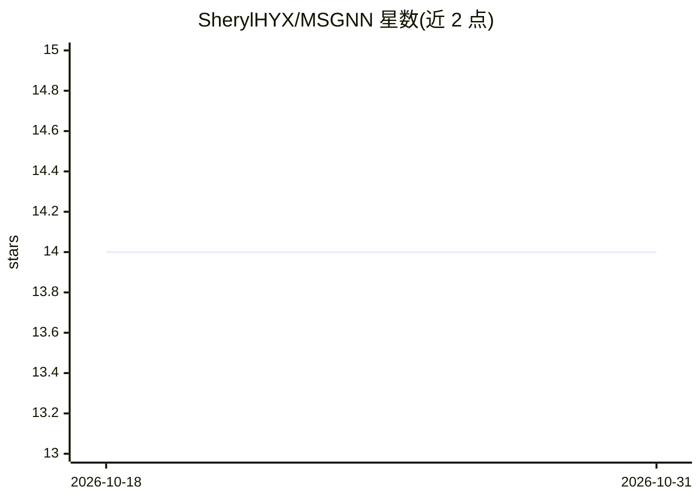

# SherylHYX/MSGNN

⭐ 14 · Python · MIT · 推送 2026-09-03 · [GitHub](https://github.com/SherylHYX/MSGNN) · 组织维护

**符号有向图神经网络 MSGNN 论文官方代码，做节点聚类与链接预测**

LoG 2022 论文 MSGNN 的官方 PyTorch 实现：基于磁性符号拉普拉斯的谱图神经网络，用于符号有向网络的节点聚类与链接预测任务。提供命令行参数配置、execution 目录下 shell 脚本批量复现实验结果（依赖 GNU parallel），src 目录含各数据集训练入口。环境要求 Python>=3.10、PyTorch>=2.4、PyG>=2.6，支持 GPU 与 CPU（--cpu）训练。README 附论文更正说明（磁势区间）与 Chebyshev 多项式阶数 K 的定义说明。

## 筛选速览

| 维度 | 判定 | 备注 |
|---|---|---|
| AI 角色 | `ai-native` | 本体是模型或模型工具 |
| 许可风险 | `permissive` | MIT |
| 部署形态 | `None` |  |
| 模型依赖 | — | README 未给出锁定关系 |
| 硬件要求 | — | 无带数字的原话,不猜 |
| 安装摩擦 | `low` | 无编译、无系统依赖或容器化 |
| 成熟度 | — | 结构信号不足 |

## 能力要点

- 磁性符号拉普拉斯谱图神经网络（MSGNN）的官方实现
- 支持节点聚类与链接预测两类任务
- 提供 execution 脚本配合 GNU parallel 批量复现论文结果
- 同一入口可运行 SigMaNet、SDGNN 等对比方法

## 适用场景

- 复现 LoG 2022 论文中的节点聚类与链接预测结果
- 在符号有向图数据（如 SDSBM、FiLL-pvCLCL、FiLL-OPCL）上训练 MSGNN
- 将 MSGNN 与 SigMaNet、SDGNN 等方法在同一框架下对比运行

## 场景标签

 · 领域:图机器学习/科研代码

## 证据(README 行号)

> L2: MSGNN: A Spectral Graph Neural Network Based on a Novel Magnetic Signed Laplacian (LoG 2022)
> L56: - ./src/ stores files to train various models, utils and metrics.
> L62: MSGNN provides the following command line arguments, which can be viewed in the ./src/parser_node.py for the node c

## 星数曲线

2026-10-18 14 → 2026-10-31 14（+0）

---
*卡片 v1 · prompt 1.4 · 生成 2026-10-31 · 置信度 high · 依据 README sha `9d622d744ae9` · [字段定义](../../DATASET.md)*
