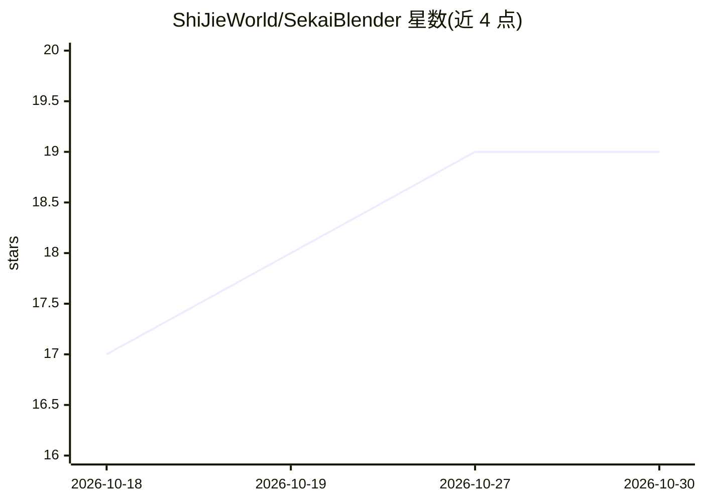

# ShiJieWorld/SekaiBlender

⭐ 19 · C++ · NOASSERTION · 推送 2026-09-18 · [GitHub](https://github.com/ShiJieWorld/SekaiBlender) · [官网](https://space.bilibili.com/3707009566247512) · 个人维护 · 中文 README

**面向 MMD 创作者的 Blender 源码级分支，原生 PMX/VMD 导入导出**

SekaiBlender 是 Blender 的 GPL-2.0+ 源码分支，以独立 Windows x64 应用形式发布（非插件，不替换现有 Blender 安装）。面向 MMD 创作者提供 PMX 2.0 导入导出（含 BDEF/SDEF 蒙皮、刚体与关节）、VMD 骨骼/形态/相机动画、CCD V8 IK 求解器、逐模型独立 Bullet 实时物理预览与 Action Bake、MMD 卡通描边及 AMD FSR 1.0 视口放大。Releases 提供 329 MB 预构建包，解压即用；也可用 CMake/VS2022 从源码构建。已知限制包括 VMD 灯光/自阴影帧不导入、QDEF/SDEF 按线性混合求值、仅接受本产品导入的 PMX 导出等。

## 筛选速览

| 维度 | 判定 | 备注 |
|---|---|---|
| AI 角色 | `ai-enhanced` | 去掉 AI 部分产品仍成立 |
| 许可风险 | `none` | NOASSERTION |
| 部署形态 | `desktop` | 安装包/桌面程序 |
| 模型依赖 | — | README 未给出锁定关系 |
| 硬件要求 | — | 无带数字的原话,不猜 |
| 安装摩擦 | `high` | 编译与系统依赖俱全 |
| 成熟度 | — | 结构信号不足 |

## 能力要点

- PMX 2.0 原生导入导出，2 个真实模型 11 个分节往返校验一致
- 原生 CCD V8 IK 求解器，支持 PMX schema 1/2 与角度限制
- 逐模型独立 Bullet 实时物理预览，多模型同场景，F8 Action Bake
- EEVEE 视口与渲染的 AMD FSR 1.0 EASU/RCAS 放大

## 适用场景

- 在单一 Windows 应用内完成 PMX 建模资产的导入、编辑与导出往返
- 制作与烘焙 VMD 骨骼/形态/相机动画
- 多 MMD 模型场景的实时物理预览与最终烘焙

## 场景标签

 · 领域:3D 图形/动画工具

## 证据(README 行号)

> L3:  MMD-native workflows for Blender.
> L17: > SekaiBlender is a source-level Blender branch for MMD creators. It is a standalone application, not an add-on, an

## 星数曲线

2026-10-18 17 → 2026-10-30 19（+2）

---
*卡片 v1 · prompt 1.4 · 生成 2026-10-28 · 置信度 low · 依据 README sha `02d18d5c3537` · [字段定义](../../DATASET.md)*
