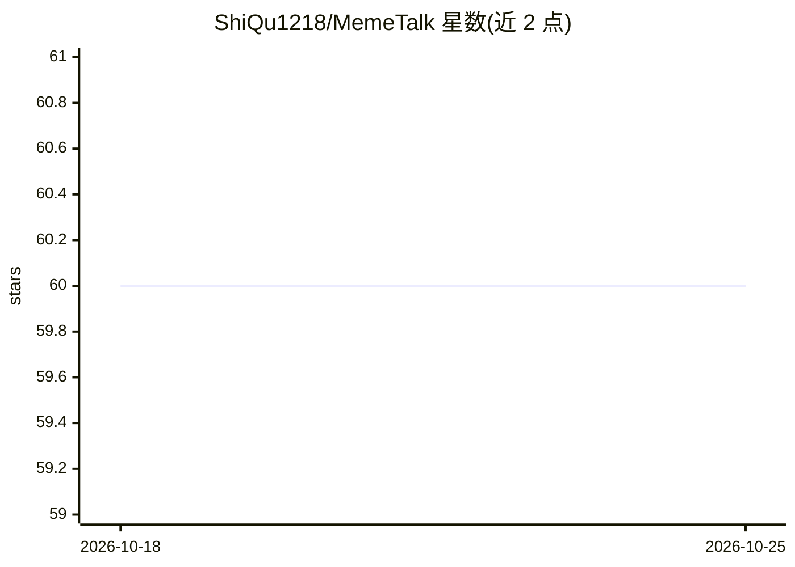

# ShiQu1218/MemeTalk

⭐ 60 · Python · 推送 2026-03-23 · [GitHub](https://github.com/ShiQu1218/MemeTalk) · 个人维护 · 中文 README

**本機梗圖搜尋系統：用 LLM 索引圖片，以文字或圖片找回梗圖**

單機版梗圖檢索系統：索引時用 Vision LLM 一次完成 OCR、場景描述、審美描述與情緒/意圖標籤，寫入 SQLite（含 FTS5）與向量庫，並建立 semantic 與 reply_text 雙向量通道。搜尋支援「適合回覆」與「契合語意」兩種任務，走多路召回（雙向量＋FTS 關鍵字/模板）、規則打分與可選 LLM rerank，也可上傳參考圖片混合檢索。提供 Streamlit UI、CLI、FastAPI 與 Telegram bot，provider 覆蓋 OpenAI/LM Studio/Ollama/llama.cpp/Gemini/Claude 等可替換後端，並附離線評估與 scoring profile 自動調權。

## 筛选速览

| 维度 | 判定 | 备注 |
|---|---|---|
| AI 角色 | `ai-native` | 本体是模型或模型工具 |
| 许可风险 | `none` | — |
| 部署形态 | `library` | 以包/库形式分发 |
| 模型依赖 | local-ok | 支持本地模型 |
| 硬件要求 | — | 无带数字的原话,不猜 |
| 安装摩擦 | `low` | 无编译、无系统依赖或容器化 |
| 成熟度 | — | 结构信号不足 |

## 能力要点

- semantic / reply_text 雙向量通道＋SQLite FTS5 多路召回
- 一次 Vision LLM 呼叫合併 OCR、場景、審美描述與標籤
- 文字／參考圖片混合查詢與偏好語氣設定
- 離線評估（precision_at_k/mrr）與 deterministic scoring profile 自動調權

## 适用场景

- 輸入一句話找一張適合回嘴或吐槽的梗圖
- 上傳參考圖片加文字，找語意情境接近的梗圖
- 把本機梗圖庫建成可檢索的結構化資料
- 透過 Telegram bot 直接回梗圖

## 场景标签

`语义搜索` · 领域:知识与检索

## 证据(README 行号)

> L3: MemeTalk 是一個本機單機版的梗圖搜尋系統。它把靜態圖片轉成可檢索的結構化資料與向量資料，支援兩種主要任務：
> L156: 4. 用 metadata provider 一次 Vision LLM 呼叫完成：
> L283: 目前支援：

## 星数曲线

2026-10-18 60 → 2026-10-25 60（+0）

---
*卡片 v1 · prompt 1.4 · 生成 2026-10-24 · 置信度 high · 依据 README sha `0f3b5b0951c1` · [字段定义](../../DATASET.md)*
