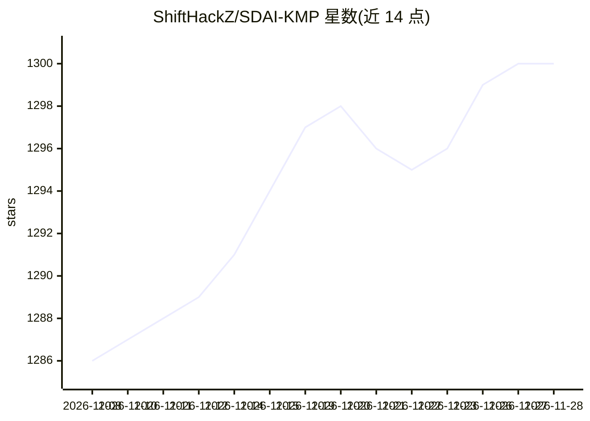

# ShiftHackZ/SDAI-KMP

⭐ 1,300 · Kotlin · AGPL-3.0 · 推送 2026-11-27 · [GitHub](https://github.com/ShiftHackZ/SDAI-KMP) · [官网](https://sdai.moroz.cc) · 个人维护

**Android/iOS 开源 AI 图像生成客户端，多后端一键接入**

Kotlin Multiplatform 编写的 Stable Diffusion 图像生成移动客户端，无广告、无遥测。支持连接自托管服务器（AUTOMATIC1111、SwarmUI、Easy Diffusion、OpenAI 兼容 API）、托管 API（Hugging Face、OpenAI、Stability AI、Fal.ai、ArliAI）、AI Horde 众包生成，以及在支持设备上的本地离线生成（ONNX、MediaPipe、stable-diffusion.cpp、Core ML、PrismML Bonsai）。提供 txt2img/img2img/局部重绘、LoRA/embeddings 选择器、本地画廊、设备基准测试等功能；Android 分 playstore/full/foss 三种构建。

## 筛选速览

| 维度 | 判定 | 备注 |
|---|---|---|
| AI 角色 | `ai-native` | 本体是模型或模型工具 |
| 许可风险 | `viral` | AGPL-3.0 |
| 部署形态 | `None` |  |
| 模型依赖 | — | README 未给出锁定关系 |
| 硬件要求 | — | 无带数字的原话,不猜 |
| 安装摩擦 | `low` | 无编译、无系统依赖或容器化 |
| 成熟度 | — | 结构信号不足 |

## 能力要点

- 接入 15+ 后端：自托管 WebUI、托管 API、AI Horde 与本地推理
- 支持本地离线生成（ONNX/MediaPipe/SDXL/Core ML/Bonsai）并可设备基准测试
- Android/iOS 共享同一移动端体验
- 本地画廊、元数据查看、Civitai 发布与 zip 导出

## 适用场景

- 用自己的 AUTOMATIC1111/SwarmUI 服务器在手机上出图
- 无网络时用手机本地模型离线生成图像
- 用 AI Horde 众包资源匿名生成
- 将生成图发布到 Civitai 画廊

## 场景标签

`图像生成` · 领域:内容生成

## 证据(README 行号)

> L18: SDAI is an independent, open-source AI image generation client for Android and iOS. It brings self-hosted AUTOMATIC
> L61: |Provider / backend|What it connects to|iOS|Android `playstore`|Android `full`|Android `foss`|Notes|

## 星数曲线

2026-11-08 1,286 → 2026-11-28 1,300（+14）

---
*卡片 v1 · prompt 1.4 · 生成 2026-11-27 · 置信度 mid · 依据 README sha `98b3a44b117e` · [字段定义](../../DATASET.md)*
