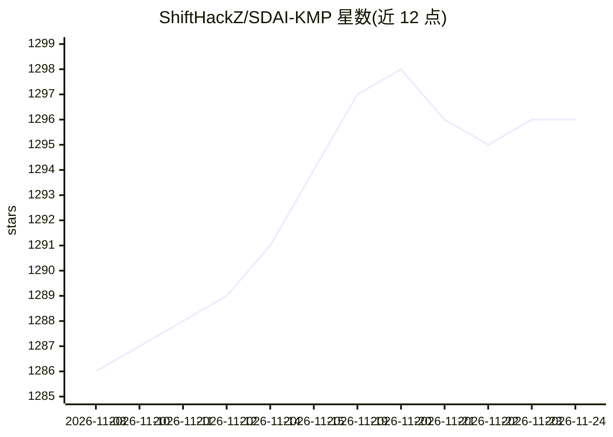

# ShiftHackZ/SDAI-KMP

⭐ 1,296 · Kotlin · AGPL-3.0 · 推送 2026-11-23 · [GitHub](https://github.com/ShiftHackZ/SDAI-KMP) · [官网](https://sdai.moroz.cc) · 组织维护

**Android/iOS 端 Stable Diffusion 图像生成客户端**

Kotlin Multiplatform 编写的开源 AI 图像生成移动客户端，连接自建 AUTOMATIC1111、SwarmUI、Easy Diffusion、OpenAI 兼容图像服务器及多家托管 API（AI Horde、Hugging Face、OpenAI、Stability AI、Fal.ai、ArliAI），并在支持的设备上提供端侧生成（ONNX、MediaPipe、stable-diffusion.cpp SDXL、Core ML、PrismML Bonsai 等）。提供 prompt/seed/CFG/LoRA 等生成控制、本地相册、端侧性能基准测试。Android 分 playstore/full/foss 三种构建，应用无广告无遥测；部分端侧功能因构建渠道或平台而受限。

## 筛选速览

| 维度 | 判定 | 备注 |
|---|---|---|
| AI 角色 | `ai-native` | 本体是模型或模型工具 |
| 许可风险 | `viral` | AGPL-3.0 |
| 部署形态 | `None` |  |
| 模型依赖 | — | README 未给出锁定关系 |
| 硬件要求 | — | 无带数字的原话,不猜 |
| 安装摩擦 | `low` | 无编译、无系统依赖或容器化 |
| 成熟度 | — | 结构信号不足 |

## 能力要点

- 单一应用支持十余种远程生成后端与多种端侧运行时
- 端侧基准测试在重负载前检测设备适配性
- Android 分 playstore/full/foss 三种构建渠道
- 提供 txt2img、img2img、inpaint、批生成与本地相册导出

## 适用场景

- 手机上连接自己的 AUTOMATIC1111/SwarmUI 服务器生成图像
- 无网络环境下用端侧模型离线生图
- 用 AI Horde 众包算力免 key 生成图像
- 将生成结果发布到 Civitai 画廊

## 场景标签

`图像生成` · 领域:内容生成

## 证据(README 行号)

> L18: SDAI is an independent, open-source AI image generation client for Android and iOS. It brings self-hosted AUTOMATIC
> L38: - Choose the backend that fits the moment: your own AUTOMATIC1111, SwarmUI, Easy Diffusion, or OpenAI-compatible im
> L61: |Provider / backend|What it connects to|iOS|Android `playstore`|Android `full`|Android `foss`|Notes|

## 星数曲线

2026-11-08 1,286 → 2026-11-24 1,296（+10）

---
*卡片 v1 · prompt 1.4 · 生成 2026-11-23 · 置信度 mid · 依据 README sha `2e15e1e4f2ce` · [字段定义](../../DATASET.md)*
