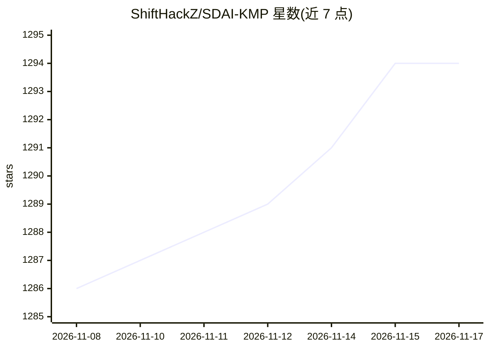

# ShiftHackZ/SDAI-KMP

⭐ 1,294 · Kotlin · AGPL-3.0 · 推送 2026-11-16 · [GitHub](https://github.com/ShiftHackZ/SDAI-KMP) · [官网](https://sdai.moroz.cc) · 个人维护 · 中文 README

**Android/iOS 上的 Stable Diffusion 图像生成客户端，聚合多种后端**

面向移动端用户的开源 AI 图像生成应用（Kotlin Multiplatform/Compose 构建），统一接入自托管 AUTOMATIC1111、SwarmUI、Easy Diffusion、OpenAI 兼容服务器、AI Horde、Hugging Face、OpenAI、Stability AI、Fal.ai、ArliAI 等托管 API，并支持 Android/iOS 端侧本地生成（ONNX、MediaPipe、stable-diffusion.cpp SDXL、Core ML、PrismML Bonsai）。生成控制覆盖提示词/负提示、种子、步数、CFG、LoRA、embeddings 等；含本地画廊、设备基准测试。无广告无遥测。通过 Google Play/F-Droid/App Store 分发，Android 分三种构建风味，部分本地能力因风味与平台而异。

## 筛选速览

| 维度 | 判定 | 备注 |
|---|---|---|
| AI 角色 | `ai-native` | 本体是模型或模型工具 |
| 许可风险 | `viral` | AGPL-3.0 |
| 部署形态 | `None` |  |
| 模型依赖 | — | README 未给出锁定关系 |
| 硬件要求 | — | 无带数字的原话,不猜 |
| 安装摩擦 | `low` | 无编译、无系统依赖或容器化 |
| 成熟度 | `idea` | |

## 能力要点

- 聚合 16 种远程与本地生成后端（A1111/SwarmUI/OpenAI 兼容/AI Horde 等）
- Android/iOS 端侧本地生成：ONNX、MediaPipe、stable-diffusion.cpp SDXL、Core ML、PrismML Bonsai
- 生成控制覆盖提示词、LoRA、embeddings、采样器、批量生成与中断
- 本地画廊、zip 导出与端侧基准测试

## 适用场景

- 在手机上连接自己的 A1111/SwarmUI 服务器生成图像
- 用 AI Horde 或托管 API 在移动端出图
- 离线/隐私场景下用端侧本地模型生成
- 用设备基准测试判断本机能否跑本地模型

## 场景标签

`图像生成` · 领域:内容生成

## 证据(README 行号)

> L17: SDAI is an independent, open-source AI image generation client for Android and iOS. It brings self-hosted AUTOMATIC
> L36: - Choose the backend that fits the moment: your own AUTOMATIC1111, SwarmUI, Easy Diffusion, or OpenAI-compatible im

## 星数曲线

2026-11-08 1,286 → 2026-11-17 1,294（+8）

---
*卡片 v1 · prompt 1.4 · 生成 2026-11-17 · 置信度 mid · 依据 README sha `e5e402e4c785` · [字段定义](../../DATASET.md)*
