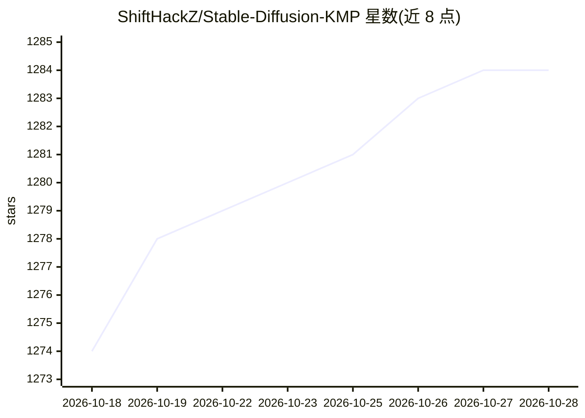

# ShiftHackZ/Stable-Diffusion-KMP

⭐ 1,283 · Kotlin · AGPL-3.0 · 推送 2026-10-19 · [GitHub](https://github.com/ShiftHackZ/Stable-Diffusion-KMP) · [官网](https://sdai.moroz.cc) · 组织维护

**Android/iOS 上的 Stable Diffusion 图像生成客户端，多后端接入**

Kotlin Multiplatform 编写的开源移动端 AI 图像生成应用，面向 Android 与 iOS 用户。支持连接自托管 AUTOMATIC1111/SwarmUI 服务器、AI Horde 众算力、Hugging Face/OpenAI/Stability AI/Fal.ai/ArliAI 等托管 API，并在支持平台上运行本地推理（Android ONNX/MediaPipe/stable-diffusion.cpp SDXL/Bonsai，iOS Core ML/MLX）。提供提示词/负面提示/LoRA/embeddings、本地画廊、设备基准测试与后端选择。Android 分 playstore/full/foss 三种构建，iOS 部分本地功能限定设备；无广告、无遥测。

## 筛选速览

| 维度 | 判定 | 备注 |
|---|---|---|
| AI 角色 | `ai-native` | 本体是模型或模型工具 |
| 许可风险 | `viral` | AGPL-3.0 |
| 部署形态 | `None` |  |
| 模型依赖 | — | README 未给出锁定关系 |
| 硬件要求 | — | 无带数字的原话,不猜 |
| 安装摩擦 | `low` | 无编译、无系统依赖或容器化 |
| 成熟度 | `idea` | |

## 能力要点

- 接入 8 种远程后端（A1111/SwarmUI/Horde/HF/OpenAI/Stability/Fal.ai/ArliAI）
- Android/iOS 平台各自的本地推理运行时（ONNX、MediaPipe、stable-diffusion.cpp、Core ML、Bonsai）
- 本地画廊含生成元数据、zip 导出与原生保存/分享
- 设备基准测试推荐本地生成设置（CPU/内存/Vulkan 探测）

## 适用场景

- 在手机上连接自己的 Stable Diffusion 服务器生成图片
- 使用 AI Horde 众算力或各家托管 API 生成图像
- 在设备本地离线跑扩散模型以保护隐私

## 场景标签

`图像生成` · 领域:内容生成

## 证据(README 行号)

> L14: SDAI is an open-source, cross-platform AI image generation client for Android and iOS. It gives you one clean mobil
> L30: - Choose the backend that fits the moment: your own AUTOMATIC1111 or SwarmUI server, AI Horde, Hugging Face, OpenAI

## 星数曲线

2026-10-18 1,274 → 2026-10-28 1,284（+10）

---
*卡片 v1 · prompt 1.4 · 生成 2026-10-21 · 置信度 mid · 依据 README sha `99438b3c4f1d` · [字段定义](../../DATASET.md)*
