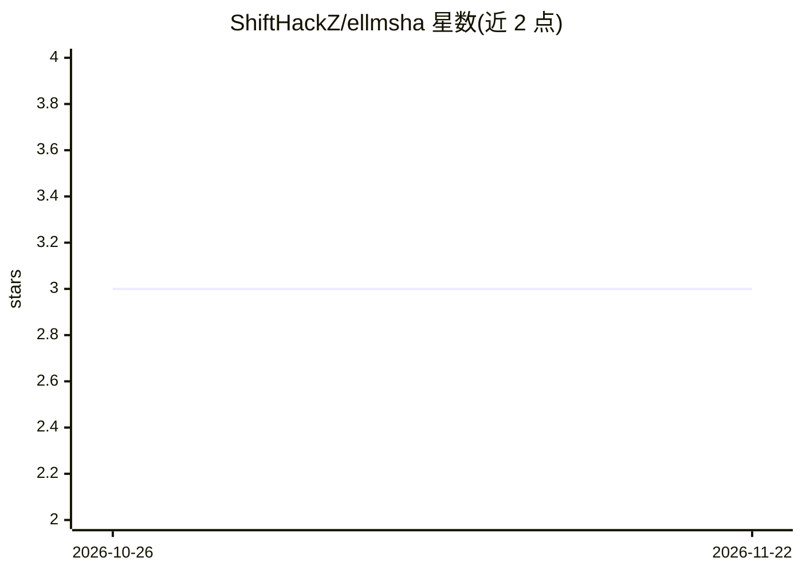

# ShiftHackZ/ellmsha

⭐ 3 · JavaScript · AGPL-3.0 · 推送 2026-11-09 · [GitHub](https://github.com/ShiftHackZ/ellmsha) · 组织维护

**给编码 agent 的本地优先工作台：项目记忆+多 agent+插件**

eLLMsha 是一个桌面优先的编码 agent 工作台（harness），把用户自选的编码 agent、持久项目记忆、多仓库项目、共享终端和可扩展工具整合到一个界面。关键机制包括：任务执行前加载项目规则、Auto Router 按 cost/speed/quality 拆分模型路由、按需加载 Skills 与 MCP 工具、项目隔离的 Chromium 浏览器 tab 与多工作账号插件（Linear/Notion/Figma 等）。桌面版内置后端与记忆服务运行时；也提供 Linux Docker 部署的 WebUI 版本。Windows 安装包目前未签名。

## 筛选速览

| 维度 | 判定 | 备注 |
|---|---|---|
| AI 角色 | `ai-ecosystem` | LLM/agent 周边工具 |
| 许可风险 | `dual` | AGPL-3.0 |
| 部署形态 | `desktop` | 安装包/桌面程序 |
| 模型依赖 | local-ok | 支持本地模型 |
| 硬件要求 | — | 无带数字的原话,不猜 |
| 安装摩擦 | `low` | 无编译、无系统依赖或容器化 |
| 成熟度 | — | 结构信号不足 |

## 能力要点

- 项目记忆与规则在任务执行前预加载，跨 agent 与会话持久
- Auto Router 分离根模型/子 agent/任务分类器，支持模型覆盖与优先级设置
- 桌面内置后端与记忆服务，无需 Docker；另提供 VPS Docker 部署
- 捆绑 Mobile MCP、Open Computer Use、Chrome DevTools MCP 等工具运行时

## 适用场景

- 在同一个工作区跨多个仓库管理编码 agent 任务
- 让 agent 记住项目决策与规范，换会话不丢上下文
- 为编码/QA/研究配置不同模型的路由与成本优先级
- 通过插件连接 Linear、Notion、Figma 等多工作账号

## 场景标签

`编码 Agent` `多智能体` `模型网关` · 领域:Agent 开发

## 证据(README 行号)

> L19: eLLMsha brings those pieces into one desktop harness. Use your preferred coding agent, keep durable project knowled
> L25: - **Build an agent team on a diagram.** Auto Router separates the root model, default subagents and task classifier
> L31: **The desktop bundles its backend, memory services and their runtime.** No Docker setup is needed for desktop memor

## 星数曲线

2026-10-26 3 → 2026-11-22 3（+0）

---
*卡片 v1 · prompt 1.4 · 生成 2026-11-22 · 置信度 high · 依据 README sha `f654df1b0ef9` · [字段定义](../../DATASET.md)*
