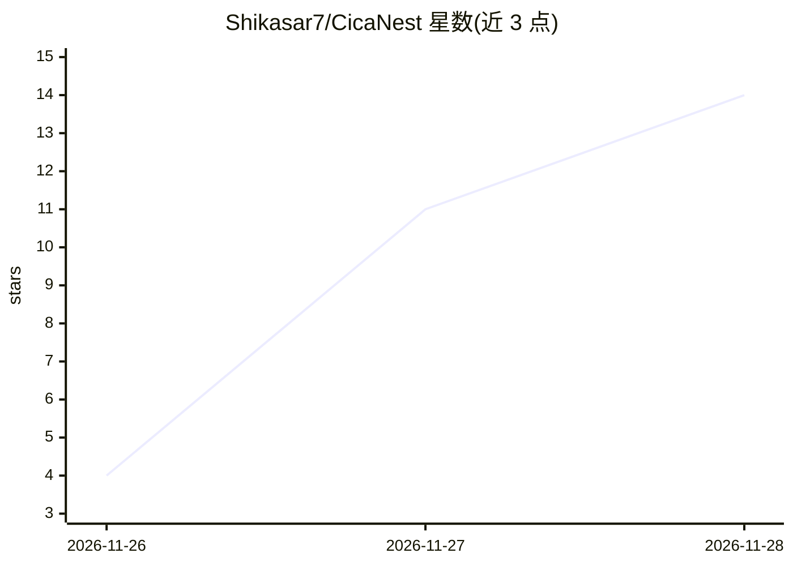

# Shikasar7/CicaNest

⭐ 14 · Python · AGPL-3.0 · 推送 2026-11-27 · [GitHub](https://github.com/Shikasar7/CicaNest) · 个人维护 · 中文 README

**自托管的 AI 伙伴：桌宠、小窝与多平台群聊 bot**

自托管的桌面 AI 伙伴与多平台 bot 系统：本地建伙伴（人设、头像、记忆），带聊天窗口、桌宠、3D 小窝和网页控制台，支持 QQ（NapCat/OneBot 11）、Discord、Telegram、Slack、企业微信接入。伙伴可执行查资料、写文件、设提醒等任务，命令默认在 Docker 容器中运行；模型走 OpenAI 兼容接口或 Anthropic。Windows 提供安装包，Mac/Linux 用 uv 运行，也可 Docker 部署。数据全部留在本机。

## 筛选速览

| 维度 | 判定 | 备注 |
|---|---|---|
| AI 角色 | `ai-native` | 本体是模型或模型工具 |
| 许可风险 | `viral` | AGPL-3.0 |
| 部署形态 | `desktop` | 安装包/桌面程序 |
| 模型依赖 | — | README 未给出锁定关系 |
| 硬件要求 | — | 无带数字的原话,不猜 |
| 安装摩擦 | `low` | 无编译、无系统依赖或容器化 |
| 成熟度 | — | 结构信号不足 |

## 能力要点

- 桌宠、桌面群与 3D 小窝，多个伙伴可同群互相接话
- QQ 经 NapCat 容器接入，Discord/Telegram/Slack/企业微信填 Token 接入
- 网页控制台管理人设、模型、bot 开关、用量与备份，支持局域网/Tailscale 手机访问
- 任务命令默认在独立 Docker 容器内运行，可授权读写本机文件夹

## 适用场景

- 在桌面上养一个有日程、能记得约定的 AI 伙伴
- 让 bot 加入 QQ/Discord 群，被点名回答、订阅变化报信
- 数据留在本机的自托管陪伴应用部署

## 场景标签

`聊天机器人` `AI 助手` · 领域:对话与助手

## 证据(README 行号)

> L1: CicaNest：给你的 AI 伙伴一个窝。陪你聊天，替你做事，也能去群里说话
> L18: 不用任何平台账号就能建。名字、人设、头像都由你写，也能从别处写好的设定和回忆导入；想先试试，就请一位示例伙伴过来。可以发表情包、图片和语音，也可以把几个伙伴拉进同一个群。
> L115: 模型支持 OpenAI 兼容接口（Chat Completions、Responses）、Anthropic，以及 ChatGPT 的 Codex 订阅。每个 bot 可以再设一个备用模型。

## 星数曲线

2026-11-26 4 → 2026-11-28 14（+10）

---
*卡片 v1 · prompt 1.4 · 生成 2026-11-26 · 置信度 high · 依据 README sha `cb932c3ee5b0` · [字段定义](../../DATASET.md)*
