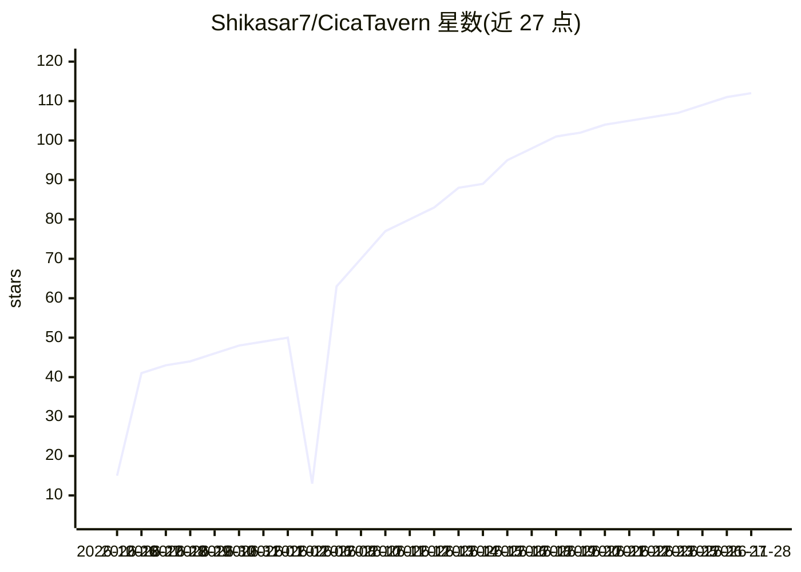

# Shikasar7/CicaTavern

⭐ 112 · JavaScript · AGPL-3.0 · 推送 2026-11-27 · [GitHub](https://github.com/Shikasar7/CicaTavern) · [官网](https://github.com/Shikasar7/CicaTavern/releases/latest) · 个人维护 · 中文 README

**SillyTavern 角色卡播放器：导入酒馆卡用自有 API 跑剧情**

以桌面/移动客户端形式运行的 SillyTavern 角色卡播放器：导入已有的角色卡、世界书与预设，接入用户自有的模型 API 进行对话演出。机制上把卡片、世界书和预设固定为前缀、每轮只追加以命中缓存；压缩掉的旧剧情记入记忆簿，剧情再提到时召回；支持视觉小说画面、掷骰与回合制战斗规则、一键配图（OpenAI 兼容接口/Gemini/NovelAI/ComfyUI/SD WebUI）与朗读，并提供分步引导的角色卡创作向导，导出 PNG 可回到 SillyTavern 使用。数据存储在本地设备。Windows 提供解压即用的 zip，Mac/Android/iPhone 安装说明见使用指南。

## 筛选速览

| 维度 | 判定 | 备注 |
|---|---|---|
| AI 角色 | `ai-native` | 本体是模型或模型工具 |
| 许可风险 | `viral` | AGPL-3.0 |
| 部署形态 | `desktop` | 安装包/桌面程序 |
| 模型依赖 | local-ok | 支持本地模型 |
| 硬件要求 | — | 无带数字的原话,不猜 |
| 安装摩擦 | `low` | 无编译、无系统依赖或容器化 |
| 成熟度 | — | 结构信号不足 |

## 能力要点

- 固定前缀+每轮追加的缓存命中设计，长对话每轮命中九成以上
- 兼容 SillyTavern 角色卡、世界书、预设、正则、MVU 变量与状态栏，聊天记录可直接导入
- 长期记忆簿（Beta）：旧剧情人物、约定、伏笔按需召回
- 引导式角色卡创作向导，导出 PNG 在 SillyTavern 中可用

## 适用场景

- 导入已有的 SillyTavern 角色卡和世界书，用自己的 API 继续玩
- 手机上随时随地玩角色扮演剧情
- 在对话中生成插图并给对白/旁白配音
- 一步步创作一张可直接导入酒馆的完整角色卡

## 场景标签

`聊天机器人` `图像生成` `语音合成` · 领域:对话与助手

## 证据(README 行号)

> L7: **An agent-style player for SillyTavern character cards.** Import the character cards, world books and presets you a
> L40: SillyTavern cards, world books, presets, regex, MVU variables, the status bars inside cards and Tavern Helper scrip

## 星数曲线

2026-10-26 15 → 2026-11-28 112（+97）

---
*卡片 v1 · prompt 1.4 · 生成 2026-11-28 · 置信度 high · 依据 README sha `4b4acdf92bd6` · [字段定义](../../DATASET.md)*
