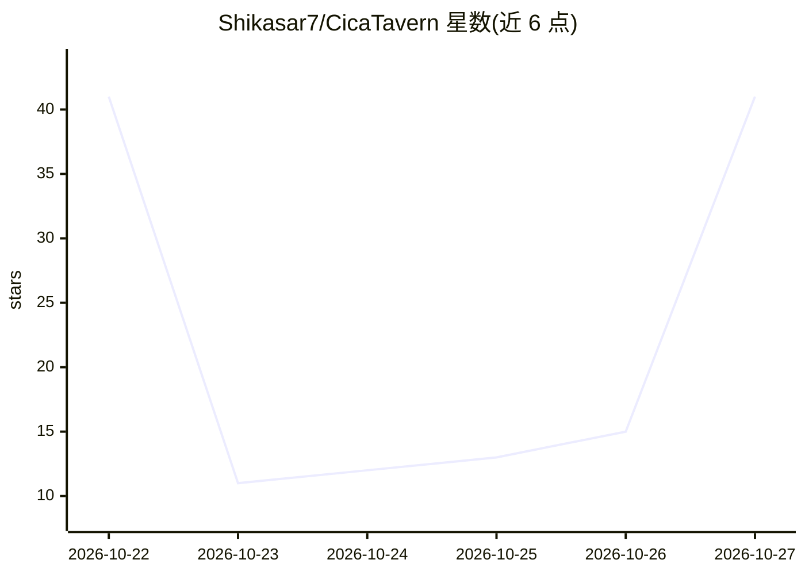

# Shikasar7/CicaTavern

⭐ 41 · JavaScript · MIT · 推送 2026-10-26 · [GitHub](https://github.com/Shikasar7/CicaTavern) · [官网](https://github.com/Shikasar7/CicaTavern/releases/latest) · 个人维护 · 中文 README

**兼容酒馆角色卡的 Agent 式角色扮演客户端，用自有模型 API 跑剧情**

桌面（Windows/macOS）与安卓端应用：导入 SillyTavern 格式的角色卡、世界书、预设、正则与 MVU 变量，用用户自备的模型 API（DeepSeek、OpenRouter、Anthropic、OpenAI、Gemini、本机 Ollama 等）进行角色扮演对话。提示词按前缀固定设计以提高缓存命中；提供一键配图（OpenAI 兼容/Gemini/NovelAI/ComfyUI/SD WebUI）、分音色朗读、语音输入、视觉小说模式与引导式角色卡创作向导。数据存本地，Windows 解压即用且自带 Node 运行环境。

## 筛选速览

| 维度 | 判定 | 备注 |
|---|---|---|
| AI 角色 | `ai-native` | 本体是模型或模型工具 |
| 许可风险 | `permissive` | MIT |
| 部署形态 | `desktop` | 安装包/桌面程序 |
| 模型依赖 | local-ok | 支持本地模型 |
| 硬件要求 | — | 无带数字的原话,不猜 |
| 安装摩擦 | `low` | 无编译、无系统依赖或容器化 |
| 成熟度 | `idea` | |

## 能力要点

- 兼容 SillyTavern V1/V2/V3 角色卡、世界书、预设、正则与 MVU 变量
- 提示词前缀固定设计，长对话每轮命中缓存并在界面显示命中率
- 一键配图（多种生图后端）与对白/旁白分音色朗读、语音输入
- 引导式创作向导分步生成角色卡，可导出 SillyTavern PNG

## 适用场景

- 导入已有的酒馆角色卡和世界书，用自己的 API Key 继续玩
- 长对话角色扮演中控制缓存费用并实时查看命中与用量
- 在手机浏览器或安卓 App 上继续桌面端的剧情
- 用创作向导从零生成一张完整角色卡

## 场景标签

`聊天机器人` · 领域:对话与助手

## 证据(README 行号)

> L7: **Agent 式的 SillyTavern 角色卡酒馆。** 导入酒馆的角色卡、世界书和预设，用**你自己的模型 API**（DeepSeek、OpenRouter、Anthropic、OpenAI、Gemini、Kimi、智谱、
> L28: - **模型之间分工**：配图时，辅助模型读这一段剧情，按角色名册写画面提示词；点「压缩上下文」，模型把剧情写成一份存档（人物、经过、伏笔、文风），换个干净的上下文接着写；创作角色卡时，向导负责规划、动笔、审稿和修改。
> L62: - **配图**：点一下，辅助模型就会根据剧情、角色长相和这张卡的画风写好画面提示词，你可以先看再画。后端可选 OpenAI 兼容图片接口（gpt-image 等）、Gemini 原生生图、NovelAI，或本地的 ComfyUI

## 星数曲线

2026-10-22 41 → 2026-10-27 41（+0）

---
*卡片 v1 · prompt 1.4 · 生成 2026-10-27 · 置信度 mid · 依据 README sha `85b7816e2204` · [字段定义](../../DATASET.md)*
