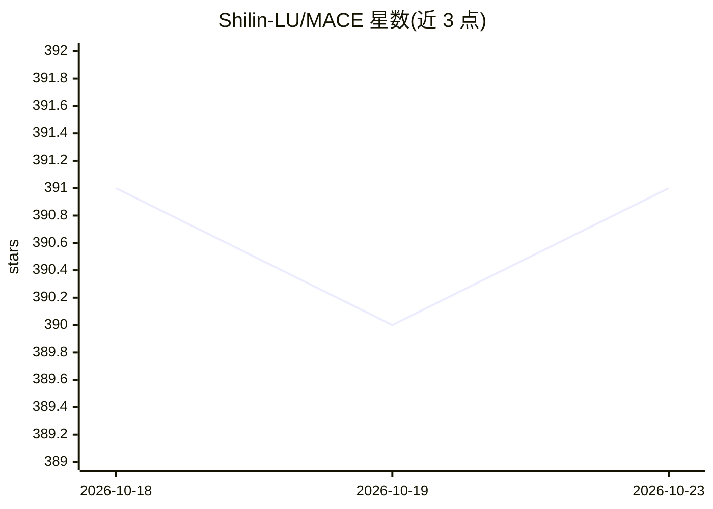

# Shilin-LU/MACE

⭐ 391 · Jupyter Notebook · NOASSERTION · 推送 2026-07-20 · [GitHub](https://github.com/Shilin-LU/MACE) · 组织维护

**CVPR 2024 官方实现：从文生图扩散模型中批量擦除概念**

面向大规模文本到图像扩散模型的概念擦除微调框架，可将擦除范围扩展至最多 100 个概念，通过闭式交叉注意力精修与逐概念 LoRA 微调消除目标概念信息，并以闭式解融合多个 LoRA 避免相互干扰。流程包括：LLM 生成文本增强（默认 OpenAI，可切 MiniMax）、Grounded-SAM 生成图像与分割掩码、训练擦除与推理采样，另提供 FID/CLIP/NudeNet 等评测脚本与已微调的 Stable Diffusion v1.4 权重。面向机器学习研究者和模型安全相关人员。

## 筛选速览

| 维度 | 判定 | 备注 |
|---|---|---|
| AI 角色 | `ai-ecosystem` | LLM/agent 周边工具 |
| 许可风险 | `none` | NOASSERTION |
| 部署形态 | `library` | 以包/库形式分发 |
| 模型依赖 | — | README 未给出锁定关系 |
| 硬件要求 | — | 无带数字的原话,不猜 |
| 安装摩擦 | `medium` | 含编译或系统依赖之一 |
| 成熟度 | — | 结构信号不足 |

## 能力要点

- 单一流程可擦除多达 100 个概念
- 闭式交叉注意力精修 + 逐概念 LoRA 微调，多 LoRA 无干扰融合
- 数据准备支持 Grounded-SAM 官方版（<24GB GPU）与 HuggingFace 版（~28GB）两种路径
- 提供四类概念（物体/名人/艺术风格/敏感内容）的已微调模型权重与多指标评测脚本

## 适用场景

- 从文生图模型中批量移除敏感或侵权概念
- 对已部署的 Stable Diffusion 做模型安全合规微调
- 复现 CVPR 2024 论文的擦除与评测实验

## 场景标签

`微调` · 领域:训练与推理

## 证据(README 行号)

> L5: Official implementation of MACE: Mass Concept Erasure in Diffusion Models.
> L18: The rapid expansion of large-scale text-to-image diffusion models has raised growing concerns regarding their poten

## 星数曲线

2026-10-18 391 → 2026-10-23 391（+0）

---
*卡片 v1 · prompt 1.4 · 生成 2026-10-21 · 置信度 mid · 依据 README sha `028f7be09a87` · [字段定义](../../DATASET.md)*
