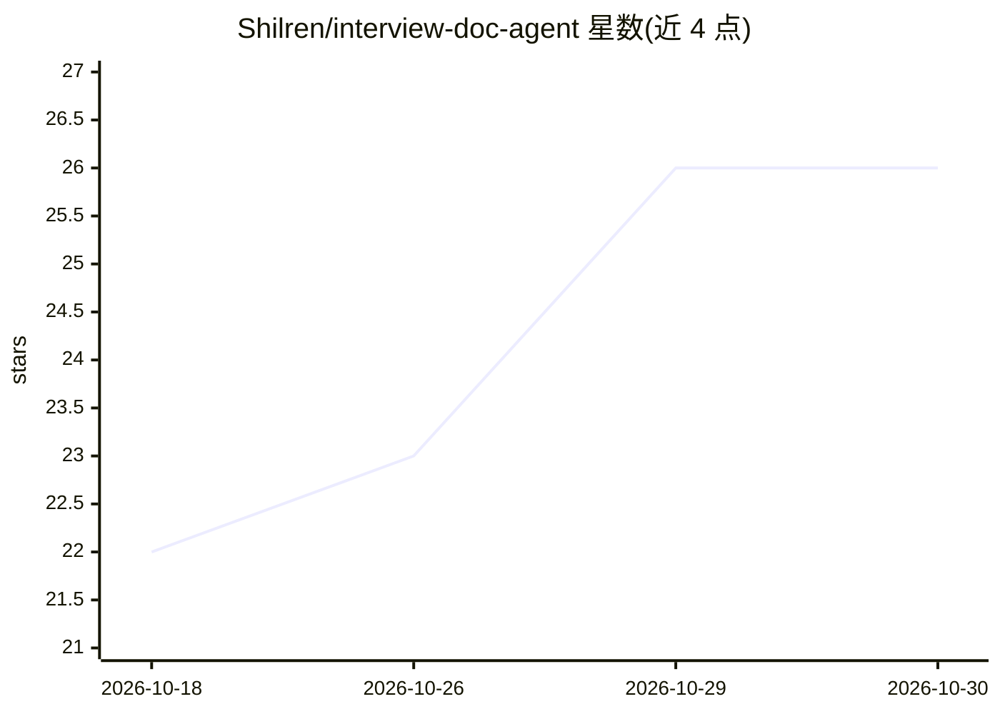

# Shilren/interview-doc-agent

⭐ 26 · MIT · 推送 2026-06-08 · [GitHub](https://github.com/Shilren/interview-doc-agent) · 个人维护 · 中文 README

**求职文档 Agent Skill：把零散经历沉淀成经历库，生成简历与面试逐字稿**

一个单文件 SKILL.md 形式的 AI Skill，供能读写本地文件、多轮对话的 AI（Obsidian Claudian 插件、飞书智能伙伴、Claude Code、Cursor 等）加载。借鉴 Karpathy LLM Wiki 三层结构：materials/ 原始素材经一次整理成「经历库」单一可信源，之后按简历模板或 jd/ 中的 JD 生成简历与简单版/复杂版逐字稿；生成时先读轻量索引只取相关经历以省 token，声明不使用 RAG。安装方式为 curl 下载单文件或粘贴到飞书指令框。

## 筛选速览

| 维度 | 判定 | 备注 |
|---|---|---|
| AI 角色 | `ai-native` | 本体是模型或模型工具 |
| 许可风险 | `permissive` | MIT |
| 部署形态 | `None` |  |
| 模型依赖 | — | README 未给出锁定关系 |
| 硬件要求 | — | 无带数字的原话,不猜 |
| 安装摩擦 | `low` | 无编译、无系统依赖或容器化 |
| 成熟度 | — | 结构信号不足 |

## 能力要点

- 单文件 SKILL.md 分发，支持 Obsidian/飞书/Coding AI 多种宿主
- 经历库单一可信源，简历与逐字稿同源生成
- 索引定位只读相关经历以省 token，明确不用 RAG
- 按 JD 定制简历，输出遵循「背景—问题—手段成果」结构

## 适用场景

- 把散落各处的项目经历整理成可复用的经历库
- 按不同岗位 JD 一键生成定制简历
- 生成面试逐字稿用于面试准备

## 场景标签

`AI 写作` · 领域:内容生成

## 证据(README 行号)

> L3: > 把零散经历沉淀成「经历库」，一键生成**简历**和**面试逐字稿**的 AI Skill。
> L46: |「写一份简历」|按模板 + 经历库生成简历 → `output/`|
> L52: 任何「能读写本地文件 + 能多轮对话」的 AI 都能用：

## 星数曲线

2026-10-18 22 → 2026-10-30 26（+4）

---
*卡片 v1 · prompt 1.4 · 生成 2026-10-27 · 置信度 high · 依据 README sha `118d301938a6` · [字段定义](../../DATASET.md)*
