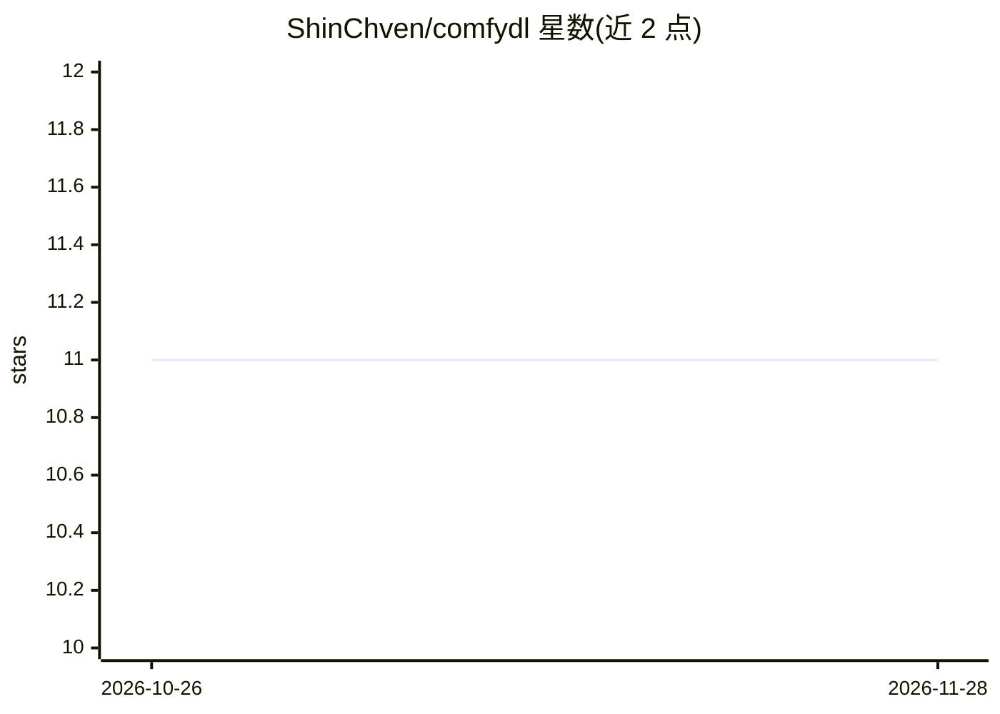

# ShinChven/comfydl

⭐ 11 · Python · MIT · 推送 2026-01-11 · [GitHub](https://github.com/ShinChven/comfydl) · 个人维护

**为 ComfyUI 用户自动下载并归位模型文件的 CLI 工具**

ComfyDL 是一个 Python 命令行工具，用于从 Hugging Face、Civitai 等来源下载模型并自动放入 ComfyUI 安装目录的对应 models/* 子目录。支持按名称、Model/Version ID、URL 或 AIR URN 下载，提供安装状态审计、按源卸载（含 dry-run）、断点续传（依赖 aria2c/wget）、远程 JSON 注册表订阅与自定义 YAML 模型源。要求 Python 3.8+，需配置 ComfyUI 根目录，Civitai/HF 的受限模型需可选 API token。

## 筛选速览

| 维度 | 判定 | 备注 |
|---|---|---|
| AI 角色 | `ai-ecosystem` | LLM/agent 周边工具 |
| 许可风险 | `permissive` | MIT |
| 部署形态 | `library` | 以包/库形式分发 |
| 模型依赖 | — | README 未给出锁定关系 |
| 硬件要求 | — | 无带数字的原话,不猜 |
| 安装摩擦 | `low` | 无编译、无系统依赖或容器化 |
| 成熟度 | — | 结构信号不足 |

## 能力要点

- 自动将模型放置到正确的 models/* 子目录
- 支持 Civitai Model ID、Version ID、URL 与 AIR URN 下载
- 远程 JSON 注册表订阅与自定义 YAML 模型源
- aria2c/wget 断点续传与磁盘空间检查

## 适用场景

- 为本地 ComfyUI 一键拉取 flux1、pony 等模型集
- 在 Colab/Jupyter 环境中为 ComfyUI 配置模型
- 审计已安装模型的大小与完整性并安全卸载

## 场景标签

 · 领域:AI 绘图/模型管理工具

## 证据(README 行号)

> L8: **ComfyDL** is a robust Command Line Interface (CLI) tool for downloading models for ComfyUI. It automates the proce
> L21: - **Smart Downloads**: Automatically places files in the correct `models/*` subdirectories (e.g., `models/ipadapter

## 星数曲线

2026-10-26 11 → 2026-11-28 11（+0）

---
*卡片 v1 · prompt 1.4 · 生成 2026-11-18 · 置信度 high · 依据 README sha `59a27efc3f47` · [字段定义](../../DATASET.md)*
