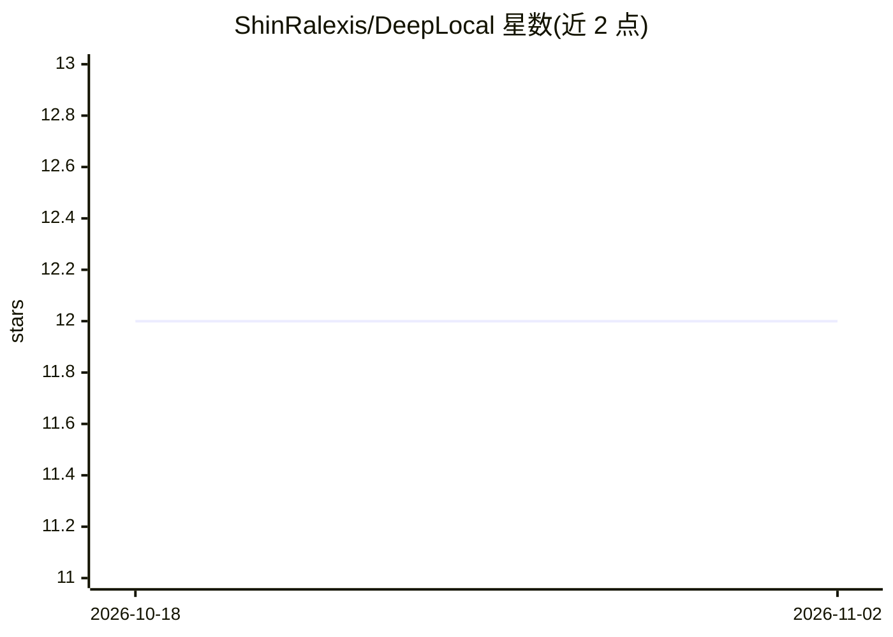

# ShinRalexis/DeepLocal

⭐ 12 · C# · 推送 2026-10-15 · [GitHub](https://github.com/ShinRalexis/DeepLocal) · 个人维护

**Windows 离线桌面翻译器：通过本地 Ollama 模型做 DeepL 式翻译**

用 C#/WPF 与 .NET 8 编写的 Windows 桌面翻译应用：双栏 DeepL 式界面，边输入边翻译（流式输出），支持 36 种语言、自动检测与交换。翻译由本机 Ollama（127.0.0.1:11434）服务的模型完成，默认 TranslateGemma 12B，也可选用已安装的其他模型，含标记为 Cloud 的云端模型（此时文本离开本机）。提供英文/意大利文自包含安装包，无需另装 .NET；文档面向需处理敏感文本的企业、律所、医院、记者等用户。

## 筛选速览

| 维度 | 判定 | 备注 |
|---|---|---|
| AI 角色 | `ai-native` | 本体是模型或模型工具 |
| 许可风险 | `none` | — |
| 部署形态 | `desktop` | 安装包/桌面程序 |
| 模型依赖 | local-ok | 支持本地模型 |
| 硬件要求 | — | 无带数字的原话,不猜 |
| 安装摩擦 | `medium` | 含编译或系统依赖之一 |
| 成熟度 | — | 结构信号不足 |

## 能力要点

- 翻译全部在本机 Ollama 上运行，默认 TranslateGemma 12B，模型菜单内可下载
- DeepL 式双栏界面，边输入边流式翻译，36 种语言含自动检测
- Alt+T 从任意应用翻译剪贴板，托盘常驻
- 也支持 Ollama 中已装的其他模型与云端模型（标记 Cloud）

## 适用场景

- 在不上传文本的前提下翻译合同、病历等敏感材料
- 日常获得 DeepL 式即输即译体验且完全离线
- 在无网络或受控环境的电脑上做翻译

## 场景标签

 · 领域:翻译/桌面工具

## 证据(README 行号)

> L6:  Your text never leaves your PC: translations run on local models served by Ollama, with TranslateGemma 12B as the d
> L32: > workflow with the translation done **entirely on your PC**: the app talks only to Ollama on

## 星数曲线

2026-10-18 12 → 2026-11-02 12（+0）

---
*卡片 v1 · prompt 1.4 · 生成 2026-11-01 · 置信度 high · 依据 README sha `2a978dd5fae7` · [字段定义](../../DATASET.md)*
