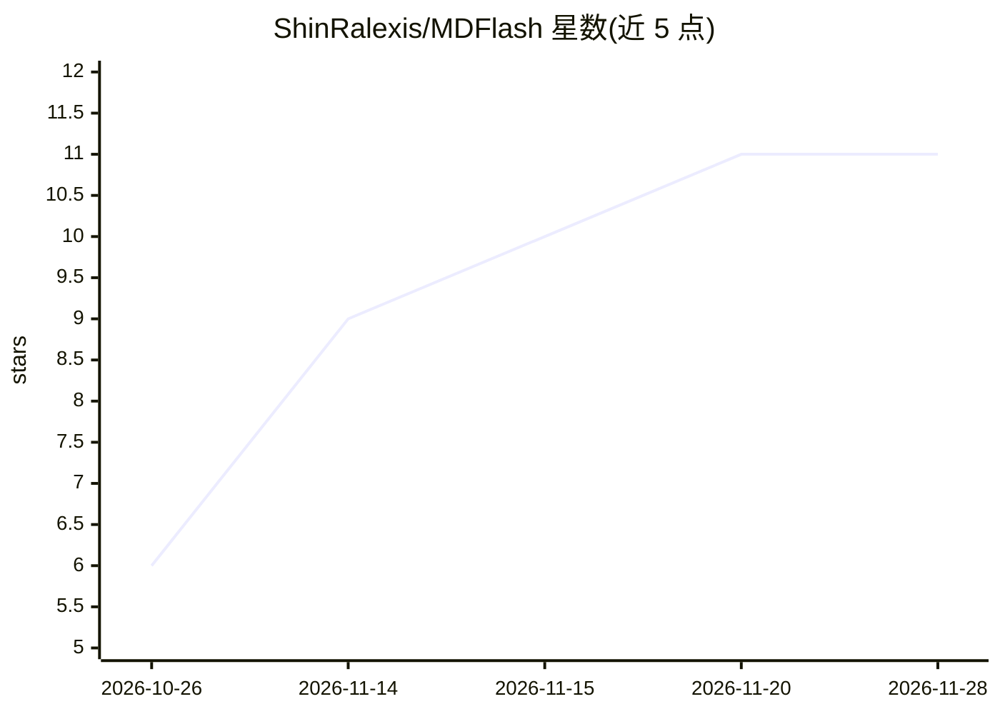

# ShinRalexis/MDFlash

⭐ 11 · C · NOASSERTION · 推送 2026-10-03 · [GitHub](https://github.com/ShinRalexis/MDFlash) · [官网](https://www.elecktrastudio.com) · 个人维护 · 中文 README

**Windows 平台的所见即所得 Markdown 编辑器，带离线 AI 助手**

用 C 与 WebView2 构建的 Windows Markdown 编辑器，边写边渲染，无需分栏预览。支持 GFM 表格、KaTeX 数学、Mermaid 图、Obsidian 式双链、YAML front matter，保留文件原有格式。内置多标签、版本历史（每次保存快照与 diff）、文件夹全文搜索、正则查找替换、专注/打字机模式，以及 PDF/HTML/Word 导出（Pandoc 扩展更多格式）。离线写作助手依赖本地运行的 Ollama，对选中文本进行修改、摘要、翻译、改写，文本不离开本机。提供 5 MB 安装包与便携模式，界面支持 9 种语言。

## 筛选速览

| 维度 | 判定 | 备注 |
|---|---|---|
| AI 角色 | `ai-enhanced` | 去掉 AI 部分产品仍成立 |
| 许可风险 | `none` | NOASSERTION |
| 部署形态 | `desktop` | 安装包/桌面程序 |
| 模型依赖 | local-ok | 支持本地模型 |
| 硬件要求 | — | 无带数字的原话,不猜 |
| 安装摩擦 | `low` | 无编译、无系统依赖或容器化 |
| 成熟度 | — | 结构信号不足 |

## 能力要点

- 所见即所得实时渲染，Ctrl+U 切换源码模式
- 版本历史：每次保存生成快照，逐行 diff 与一键还原
- 离线 AI 写作助手：本地 Ollama 处理选中文本，流式输出
- C 程序约 260 KB，依赖系统自带的 WebView2，无需 Electron

## 适用场景

- 在 Windows 上以 Typora 风格写作和编辑 Markdown 笔记
- 离线环境下用本地模型对文本做润色、摘要或翻译
- 管理带双链与 front matter 的个人知识库文档

## 场景标签

`AI 写作` `知识库管理` · 领域:内容生成

## 证据(README 行号)

> L5:  A fast WYSIWYG Markdown editor for Windows, written in C.
> L64: - With Ollama running locally, press **Ctrl+J** to fix, improve, shorten, expand, summarize, translate or rewrite t

## 星数曲线

2026-10-26 6 → 2026-11-28 11（+5）

---
*卡片 v1 · prompt 1.4 · 生成 2026-11-20 · 置信度 high · 依据 README sha `b8b9604ded5c` · [字段定义](../../DATASET.md)*
