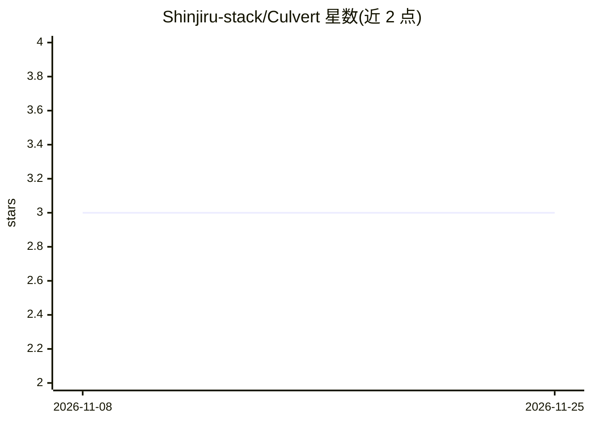

# Shinjiru-stack/Culvert

⭐ 3 · Rust · MIT · 推送 2026-10-22 · [GitHub](https://github.com/Shinjiru-stack/Culvert) · 个人维护

**Windows 原生 SSH 客户端，带自然语言操作服务器的 AI Copilot**

用 Rust（egui + russh）构建的 Windows 桌面 SSH 客户端：标签页终端（内置 vt100 模拟器）、点选式本地/远程/SOCKS5 动态端口转发、SFTP 文件浏览器、服务器监控条、宏与分组会话管理。AI Copilot 侧栏以自然语言驱动同样的会话、隧道与文件操作：模型仅提出结构化工具调用，Culvert 按风险分类，只读命令直接执行，状态变更等待审批卡，密钥在发送给 provider 前被脱敏。单个自包含 .exe，无 webview 与外部 SSH 依赖，可接本地 Ollama 完全离线。

## 筛选速览

| 维度 | 判定 | 备注 |
|---|---|---|
| AI 角色 | `ai-enhanced` | 去掉 AI 部分产品仍成立 |
| 许可风险 | `permissive` | MIT |
| 部署形态 | `desktop` | 安装包/桌面程序 |
| 模型依赖 | local-ok | 支持本地模型 |
| 硬件要求 | — | 无带数字的原话,不猜 |
| 安装摩擦 | `medium` | 含编译或系统依赖之一 |
| 成熟度 | — | 结构信号不足 |

## 能力要点

- 模型仅提议工具调用，风险分类 + 审批卡把关危险命令
- 密钥在到达 provider 前经脱敏网关，凭据输入仅在本地掩码字段
- 支持 OpenRouter/OpenAI/Groq/Gemini/Anthropic 或本地 Ollama 离线运行
- 点选式本地/远程/动态 SOCKS5 端口转发与 SFTP 文件管理

## 适用场景

- 用自然语言让 Copilot 执行服务器检查、建隧道、加主机等操作
- 图形化管理 SSH 会话与端口转发，无需手写 ssh -L 命令
- 离线环境下用本地 Ollama 管理 内网 服务器

## 场景标签

 · 领域:开发运维工具/桌面 SSH 客户端

## 证据(README 行号)

> L5: **A native desktop SSH client, tunnel manager, SFTP browser — and an AI Copilot
> L12: approval card, and redacts secrets before they reach a provider. One self-contained `.exe`: no webview, no external
> L32: - **AI Copilot** — a chat panel beside the workspace that drives the same

## 星数曲线

2026-11-08 3 → 2026-11-25 3（+0）

---
*卡片 v1 · prompt 1.4 · 生成 2026-11-22 · 置信度 high · 依据 README sha `aba8227a6012` · [字段定义](../../DATASET.md)*
