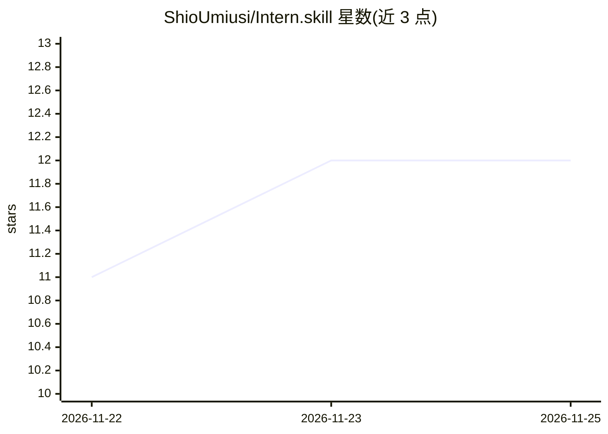

# ShioUmiusi/Intern.skill

⭐ 12 · NOASSERTION · 推送 2026-11-21 · [GitHub](https://github.com/ShioUmiusi/Intern.skill) · 个人维护 · 中文 README

**给 Agent 使用者的可粘贴工作方法文档**

一份可直接粘贴进 AGENTS.md 的工作方法参考，围绕假说演绎法组织，包含 Abduction、Falsifiability、Bayesian 等工具箱关键词与「取前提·授权内判断·越权先问·不装懂·别拖·别编」六句运行条件，目标是让 Agent 能交付、肯提问、给结论列证据并标注推断。不依赖框架、不配插件，通过复制 RULES.md 即可使用；作者自述不保证模型 100% 遵守。

## 筛选速览

| 维度 | 判定 | 备注 |
|---|---|---|
| AI 角色 | `ai-knowledge` | 知识聚合/清单类 |
| 许可风险 | `none` | NOASSERTION |
| 部署形态 | `None` |  |
| 模型依赖 | — | README 未给出锁定关系 |
| 硬件要求 | — | 无带数字的原话,不猜 |
| 安装摩擦 | `low` | 无编译、无系统依赖或容器化 |
| 成熟度 | — | 结构信号不足 |

## 能力要点

- 以假说演绎法为核心的工作方法（观察→溯因→预测→找证据→证伪）
- 关键词激活式设计，不依赖框架与插件
- 要求每个结论可指回来源，指不回的标「推断」
- 提供 RULES.md 与更短的 examples/AGENTS.md 两种版本

## 适用场景

- 给编码 Agent 配置方法论约束，让结论可追溯
- 运维排障等前提信息不完整的工作场景
- 减少模型在不清楚需求时编造前提的行为

## 场景标签

`提示工程` · 领域:Agent 开发

## 证据(README 行号)

> L12: **一个能出活、肯问、会列证据的 Agent 工作方法。**
> L31: 一份可直接粘贴进 `AGENTS.md` 的工作方法参考。
> L43: **激活，不是安装**：不写长篇解释，不配重插件。关键词点到，模型已有的方法论自己启动。

## 星数曲线

2026-11-22 11 → 2026-11-25 12（+1）

---
*卡片 v1 · prompt 1.4 · 生成 2026-11-22 · 置信度 high · 依据 README sha `21925ea0daec` · [字段定义](../../DATASET.md)*
