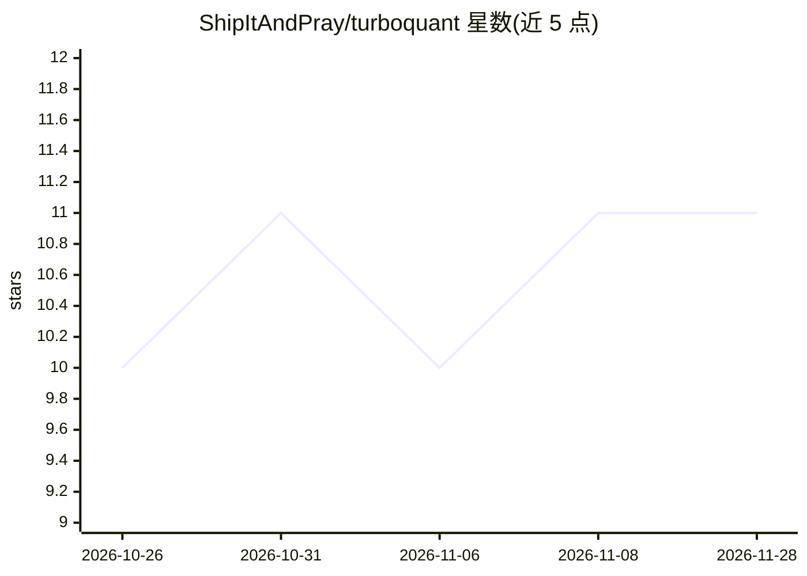

# ShipItAndPray/turboquant

⭐ 11 · Python · MIT · 推送 2026-03-25 · [GitHub](https://github.com/ShipItAndPray/turboquant) · 个人维护

**给开发者的向量与 LLM 一键量化压缩 CLI**

提供两块能力：一是向量压缩引擎，基于 PolarQuant 与 QJL 两阶段量化，通过 24 个适配器接入 Redis、PostgreSQL、Pinecone、FAISS 等缓存、数据库、向量库与存储系统，统一 put/get/search 接口并支持重排序模式；二是 LLM 量化 CLI，将 HuggingFace 模型转换为 GGUF/GPTQ/AWQ 格式，按目标平台（Ollama/vLLM/llama.cpp/LM Studio）自动选格式，支持发布到 HuggingFace Hub、质量评估与硬件检测推荐，并提供 GitHub Action 做 CI 量化。要求 Python 3.9+，核心引擎仅依赖 NumPy，LLM CLI 需 PyTorch 2.0+。

## 筛选速览

| 维度 | 判定 | 备注 |
|---|---|---|
| AI 角色 | `ai-ecosystem` | LLM/agent 周边工具 |
| 许可风险 | `permissive` | MIT |
| 部署形态 | `library` | 以包/库形式分发 |
| 模型依赖 | local-ok | 支持本地模型 |
| 硬件要求 | `cpu-ok` | |
| 安装摩擦 | `low` | 无编译、无系统依赖或容器化 |
| 成熟度 | — | 结构信号不足 |

## 能力要点

- 24 个适配器统一 put/get/search API，覆盖缓存、数据库、向量库、对象存储
- 两阶段量化（PolarQuant + QJL），无需训练，README 给出约 6x 压缩基准数据
- LLM CLI 按目标平台（Ollama/vLLM/llama.cpp/LM Studio）自动选择格式与位数
- 支持质量评估（perplexity 分级）、硬件检测推荐与 GitHub Action CI 量化

## 适用场景

- 向量检索场景下压缩 embedding 存储、降低内存占用
- 把微调后的模型量化成 GGUF 供 Ollama/llama.cpp 本地运行
- 在 CI 流水线中训练后自动量化并推送到 HuggingFace Hub

## 场景标签

`模型量化` · 领域:训练与推理

## 证据(README 行号)

> L12:  Based on Google's TurboQuant — PolarQuant + QJL. No training required. Near-zero accuracy loss.
> L220: ### Ollama (one command, ready to run)

## 星数曲线

2026-10-26 10 → 2026-11-28 11（+1）

---
*卡片 v1 · prompt 1.4 · 生成 2026-11-18 · 置信度 high · 依据 README sha `9175ae472be6` · [字段定义](../../DATASET.md)*
