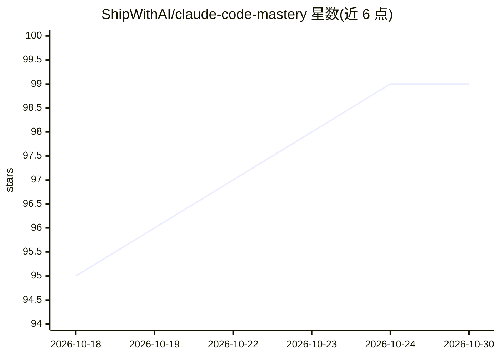

# ShipWithAI/claude-code-mastery

⭐ 99 · MDX · MIT · 推送 2026-10-01 · [GitHub](https://github.com/ShipWithAI/claude-code-mastery) · [官网](https://course.shipwithai.io) · 组织维护

**面向开发者的 Claude Code 系统化免费课程（16 阶段 64 模块）**

由 ShipWithAI 维护的 Claude Code 教学课程站点：以 16 个阶段、64 个模块组织，覆盖安装、安全沙箱、上下文管理、多 Agent 与全自动化、无头模式与 CI/CD 集成、成本优化、团队协作与实战案例等内容。内容针对 Claude Code v2.1.278 校验，提供英语与越南语双语完整版本，采用 CC BY-NC-SA 4.0 许可。站点基于 Astro 构建，可在线阅读或 git clone 后 npm install 本地运行，每阶段含练习与解答。

## 筛选速览

| 维度 | 判定 | 备注 |
|---|---|---|
| AI 角色 | `ai-knowledge` | 知识聚合/清单类 |
| 许可风险 | `permissive` | MIT |
| 部署形态 | `library` | 以包/库形式分发 |
| 模型依赖 | — | README 未给出锁定关系 |
| 硬件要求 | — | 无带数字的原话,不猜 |
| 安装摩擦 | `low` | 无编译、无系统依赖或容器化 |
| 成熟度 | — | 结构信号不足 |

## 能力要点

- 16 阶段 64 模块的渐进式课程结构
- 英语与越南语双语完整版本
- 针对 Claude Code v2.1.278 校验并提供审计文档（docs/audit/）
- 基于 Astro 构建，可本地 npm 运行

## 适用场景

- 系统学习 Claude Code 从入门到生产实践的工作流
- 团队按阶段清单跟踪学习进度并统一规范
- 在 CI/CD 与无头模式下集成 Claude Code 前查阅模式与 SDK 用法

## 场景标签

`教程课程` · 领域:学习与行业

## 证据(README 行号)

> L3: **The most comprehensive, free course on mastering Claude Code — Anthropic's AI coding agent.**
> L30: |#|Phase|Modules|What You'll Master|
> L92: |🇬🇧 English|`src/content/docs/en/`|✅ Complete|

## 星数曲线

2026-10-18 95 → 2026-10-30 99（+4）

---
*卡片 v1 · prompt 1.4 · 生成 2026-10-23 · 置信度 high · 依据 README sha `875067ff8196` · [字段定义](../../DATASET.md)*
