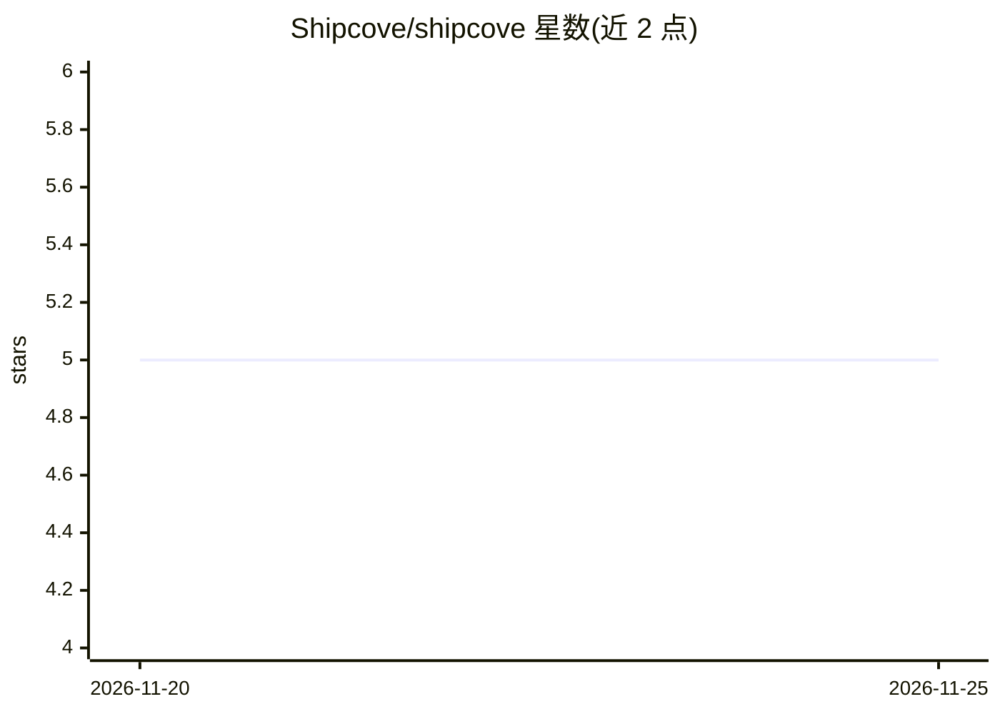

# Shipcove/shipcove

⭐ 5 · TypeScript · AGPL-3.0 · 推送 2026-11-20 · [GitHub](https://github.com/Shipcove/shipcove) · 组织维护 · 中文 README

**团队自托管的编码代理平台：沙箱中自主改码开 PR**

面向团队的自托管编码代理平台：每个开发者获得一个运行在隔离、一次性沙箱中的 AI 代理，读取、编辑、测试代码，自行推送分支并开启 pull request，不可逆操作前等待人工批准。模型经用户自己的 LLM 网关（LiteLLM）接入，机密存于 Vault，会话状态持续检查点到 S3。支持 Docker Compose 单机部署与 Helm/Kubernetes 部署，内置 OIDC/SAML/LDAP 单点登录、配额与审计日志。当前限制包括多主机内部流量加密、备份恢复工具与可观测性尚待完善。

## 筛选速览

| 维度 | 判定 | 备注 |
|---|---|---|
| AI 角色 | `ai-native` | 本体是模型或模型工具 |
| 许可风险 | `viral` | AGPL-3.0 |
| 部署形态 | `self-host` | docker 或自建部署 |
| 模型依赖 | — | README 未给出锁定关系 |
| 硬件要求 | — | 无带数字的原话,不猜 |
| 安装摩擦 | `low` | 无编译、无系统依赖或容器化 |
| 成熟度 | — | 结构信号不足 |

## 能力要点

- 代理在加固沙箱中运行：非特权用户、出口仅经允许列表代理
- 网关动态替换 OAuth 令牌，沙箱内不见 forge 凭据；推送/合并需人工内联批准
- 每次变更后检查点到 S3，支持会话恢复与任意消息回退
- LiteLLM 模型接入、按用户滚动窗口配额、Skills 与 MCP 扩展

## 适用场景

- 团队让 AI 代理在隔离沙箱中完成编码任务并提交 PR
- 企业内网自托管代码代理并接入现有 SSO 与 LLM 网关
- 需要对代理的危险 Git 操作做人工审批与审计

## 场景标签

`编码 Agent` · 领域:编码与开发

## 证据(README 行号)

> L10: **A self-hosted coding agent platform for your teams.** Shipcove gives every developer an AI agent that works in an
> L25: - **Your models, your rules.** Any provider behind LiteLLM, with per-user quotas over rolling 5-hour and 7-day wind
> L36: |**Sandboxes**|Docker or Kubernetes, CPU/memory/process limits, idle shutdown, a **startup script** set by administ

## 星数曲线

2026-11-20 5 → 2026-11-25 5（+0）

---
*卡片 v1 · prompt 1.4 · 生成 2026-11-21 · 置信度 mid · 依据 README sha `579fe1bea797` · [字段定义](../../DATASET.md)*
