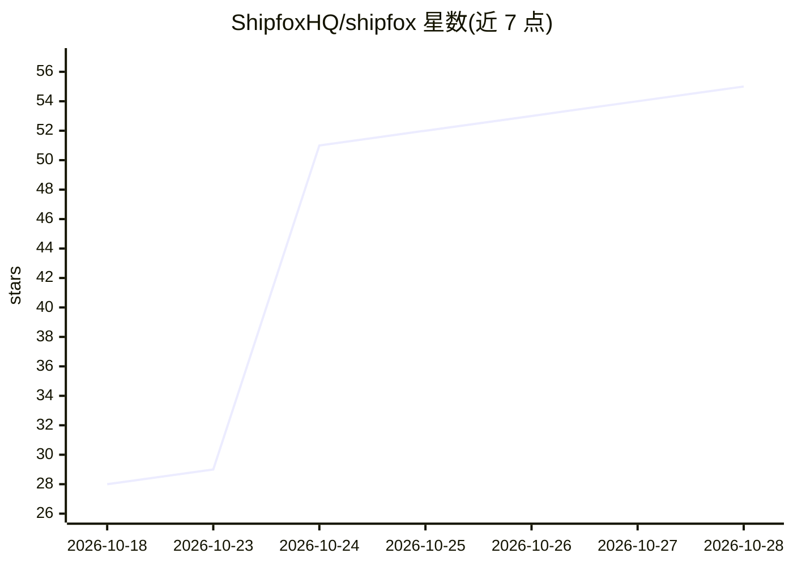

# ShipfoxHQ/shipfox

⭐ 55 · TypeScript · MIT · 推送 2026-10-27 · [GitHub](https://github.com/ShipfoxHQ/shipfox) · [官网](https://www.shipfox.io) · 组织维护

**给工程团队的开源自托管 AI 编码代理工作流平台**

Shipfox 是一个 MIT 许可、可自托管的软件工厂平台：以 YAML 工作流在仓库中定义 agent、tool、run 步骤，由工单、PR、告警、定时等事件触发，在隔离 runner 上运行编码代理，失败测试可回环重试，结果以 PR 形式交付。支持 GitHub、Sentry、Slack、Linear 等集成触发与通用 webhook；agent 步骤可选 pi harness（30+ 模型供应商）或 claude harness（Anthropic key 上的 Claude Agent SDK）。Shippy AI 功能观察运行记录并以 PR 形式持续改进工作流。自托管安装见专门文档。

## 筛选速览

| 维度 | 判定 | 备注 |
|---|---|---|
| AI 角色 | `ai-ecosystem` | LLM/agent 周边工具 |
| 许可风险 | `permissive` | MIT |
| 部署形态 | `None` |  |
| 模型依赖 | — | README 未给出锁定关系 |
| 硬件要求 | — | 无带数字的原话,不猜 |
| 安装摩擦 | `low` | 无编译、无系统依赖或容器化 |
| 成熟度 | — | 结构信号不足 |

## 能力要点

- YAML 定义工作流，事件驱动在隔离 runner 上运行编码代理
- gate 失败回环重试与跨批次持续运行的 listening job
- pi harness 支持 30+ 模型供应商，claude harness 使用 Claude Agent SDK
- MIT 许可、开源可自托管，run 级成本与日志可见

## 适用场景

- 自动分诊监控告警并产出修复 PR
- 把工单转成代码并响应 review 评论
- 自动修复失败的 CI 检查
- 按团队规范用代理评审新 PR

## 场景标签

`Agent 框架` `工作流自动化` · 领域:Agent 开发

## 证据(README 行号)

> L28: Run on Shipfox Cloud or on your own infrastructure. Any model per step, any
> L74: - **Your harness, your keys.** Run an agent step on the `pi` harness (any of 30+
> L77: - **Open source and self-hostable.** The whole platform is MIT licensed. Run it

## 星数曲线

2026-10-18 28 → 2026-10-28 55（+27）

---
*卡片 v1 · prompt 1.4 · 生成 2026-10-24 · 置信度 high · 依据 README sha `068baf47133b` · [字段定义](../../DATASET.md)*
