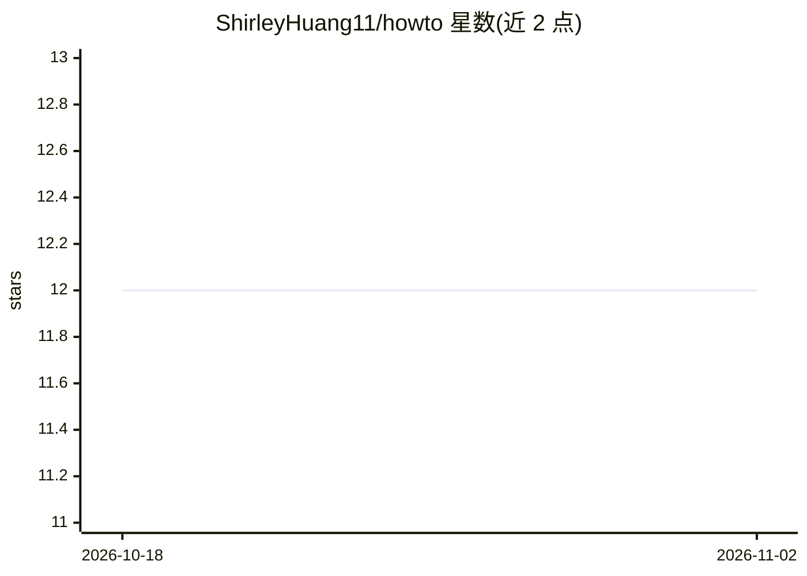

# ShirleyHuang11/howto

⭐ 12 · Python · NOASSERTION · 推送 2026-09-23 · [GitHub](https://github.com/ShirleyHuang11/howto) · 个人维护

**面向 agent/机器人训练的日常操作程序性知识库（2937 条配方，17 域）**

结构化 how-to 配方语料库：每个任务一个 markdown 文件，统一骨架为 Goal→Preconditions→Steps（每步附预期观察）→分支→失败恢复→验证→变体与安全标注，覆盖日常生活、机器人具身任务、数字操作、商务、软件工程与 LLM 工程等 17 域。可同时派生 SFT 轨迹、可验证奖励的 RL 任务、技能 DAG、RAG 技能库与评测集。提供 MCP server（search_howto/get_howto）与在线浏览器，可被 Claude Code/Cursor 等 agent 在推理时检索。MIT 许可，内容 CC BY 4.0。

## 筛选速览

| 维度 | 判定 | 备注 |
|---|---|---|
| AI 角色 | `ai-knowledge` | 知识聚合/清单类 |
| 许可风险 | `permissive` | NOASSERTION |
| 部署形态 | `self-host` | docker 或自建部署 |
| 模型依赖 | — | README 未给出锁定关系 |
| 硬件要求 | — | 无带数字的原话,不猜 |
| 安装摩擦 | `low` | 无编译、无系统依赖或容器化 |
| 成熟度 | — | 结构信号不足 |

## 能力要点

- 每步含预期观察、分支与失败恢复的结构化配方 schema
- 一个语料可派生 SFT/RL/课程/RAG/评测多种训练产物
- MCP server 暴露 search_howto/get_howto 供 agent 推理时检索
- 具身任务 frontmatter 指定物体、affordances、workspace 与安全条件

## 适用场景

- 为 web/计算机操作 agent 或家务机器人补充程序性常识
- 构建带可验证奖励的 agentic RL 任务与评测集
- 通过 MCP 让 Claude Code/Cursor 在执行任务时检索已验证步骤
- 作为人类的日常操作手册查阅

## 场景标签

 · 领域:AI 训练数据/程序性知识

## 证据(README 行号)

> L5: **Structured how-to recipes for training agents 🤖 and robots 🦾, readable by humans 🧑**
> L63: The schema turns prose into training substrate. One corpus yields, simultaneously:
> L88: One task = one markdown file, separated by domain (`domains.json` is the registry, `INDEX.md` is the full linked in

## 星数曲线

2026-10-18 12 → 2026-11-02 12（+0）

---
*卡片 v1 · prompt 1.4 · 生成 2026-11-01 · 置信度 mid · 依据 README sha `fb6b94783595` · [字段定义](../../DATASET.md)*
