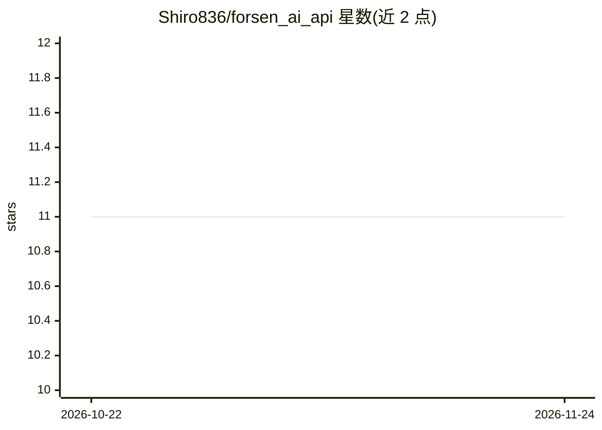

# Shiro836/forsen_ai_api

⭐ 11 · Go · MIT · 推送 2026-11-13 · [GitHub](https://github.com/Shiro836/forsen_ai_api) · [官网](https://forsen.fun) · 个人维护

**为 Twitch 主播提供观众点播的 AI 娱乐互动服务**

面向 Twitch 主播的娱乐服务：观众通过频道奖励按钮触发 AI 角色，支持自定义人设、图像与语音，控制面板可跳过不想要的请求。使用 LLM 生成角色回复，TTS 采用 Index-TTS（支持 forsen 风格的 soundbite 与音频滤镜变体），支持 AI 角色互聊。提供 OBS 脚本绑定跳过快捷键；静态文件用 MinIO 存储，数据用 PostgreSQL。含词过滤列表，可过滤观众请求与 AI 回复中的词汇。

## 筛选速览

| 维度 | 判定 | 备注 |
|---|---|---|
| AI 角色 | `ai-native` | 本体是模型或模型工具 |
| 许可风险 | `permissive` | MIT |
| 部署形态 | `None` |  |
| 模型依赖 | — | README 未给出锁定关系 |
| 硬件要求 | — | 无带数字的原话,不猜 |
| 安装摩擦 | `low` | 无编译、无系统依赖或容器化 |
| 成熟度 | — | 结构信号不足 |

## 能力要点

- 观众通过 Twitch 奖励按钮触发 AI 角色互动
- 自定义角色人设、图像与语音（含 Obiwan 语音、Index-TTS）
- 控制面板共享与跳过 unwanted 请求
- 多种互动形式：AI 对话、AI 互聊、TTS 及带滤镜的 forsen 风格 TTS

## 适用场景

- Twitch 直播中让观众点播 AI 角色互动
- 创建自定义 AI 人设与语音的直播节目
- 需要审核与跳过 AI 内容的主播场景

## 场景标签

`聊天机器人` · 领域:对话与助手

## 证据(README 行号)

> L3: ## Funny character AI using twitch reward buttons with:
> L6: - Uses state of the art TTS and best role playing LLM models.

## 星数曲线

2026-10-22 11 → 2026-11-24 11（+0）

---
*卡片 v1 · prompt 1.4 · 生成 2026-11-18 · 置信度 mid · 依据 README sha `6530d5b36dda` · [字段定义](../../DATASET.md)*
