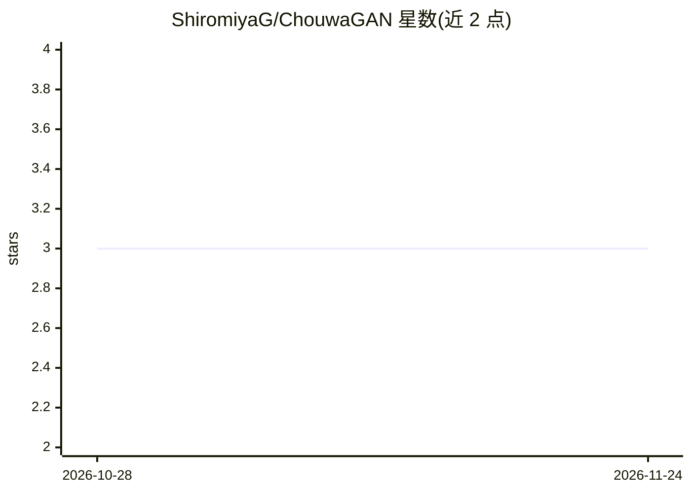

# ShiromiyaG/ChouwaGAN

⭐ 3 · Python · MIT · 推送 2026-10-19 · [GitHub](https://github.com/ShiromiyaG/ChouwaGAN) · 个人维护

**歌声合成的 mel 声码器：仅预测源增益的 ConvNeXt 网络**

面向歌声合成的 mel 声码器模型：帧率 ConvNeXt 读取归一化 log mel 与 f0，预测解析脉冲串与声门噪声两组源信号的逐频带增益，经短时谱 overlap-add 合成音频，音频采样率层无网络运算。支持 32/40/44.1/48 kHz 四档配置，导出权重加载于 ShiroRVC（44.1 kHz 兼容 Applio 移植版）。提供预处理、RMVPE 基频提取、训练、微调与推理脚本，训练需 CUDA GPU，推理可在 CPU 上运行。

## 筛选速览

| 维度 | 判定 | 备注 |
|---|---|---|
| AI 角色 | `ai-native` | 本体是模型或模型工具 |
| 许可风险 | `permissive` | MIT |
| 部署形态 | `library` | 以包/库形式分发 |
| 模型依赖 | — | README 未给出锁定关系 |
| 硬件要求 | — | 无带数字的原话,不猜 |
| 安装摩擦 | `medium` | 含编译或系统依赖之一 |
| 成熟度 | — | 结构信号不足 |

## 能力要点

- ConvNeXt 仅预测源增益，合成由解析脉冲串与声门噪声的 overlap-add 完成，音频率层无网络运算
- 支持 32/40/44.1/48 kHz 四档采样率，配置文件化管理
- 提供从预处理、RMVPE 提取基频、训练、微调到推理的完整脚本链
- 导出权重可直接加载于 ShiroRVC，44.1 kHz 兼容 Applio

## 适用场景

- 为 RVC 类歌声转换流程提供 mel 到音频的声码器
- 用自己的歌声录音训练专属声码器
- 对新音色做声码器微调适配

## 场景标签

 · 领域:音频/语音合成

## 证据(README 行号)

> L3: A mel vocoder whose network predicts only coarse gains. A frame-rate ConvNeXt
> L21: It renders the mel of ShiroRVC's rectified flow: 128 bins from 0 Hz to Nyquist,
> L46: Python 3.10+ and PyTorch 2.4 or newer; a CUDA GPU for training.

## 星数曲线

2026-10-28 3 → 2026-11-24 3（+0）

---
*卡片 v1 · prompt 1.4 · 生成 2026-11-22 · 置信度 mid · 依据 README sha `f47caa54888e` · [字段定义](../../DATASET.md)*
